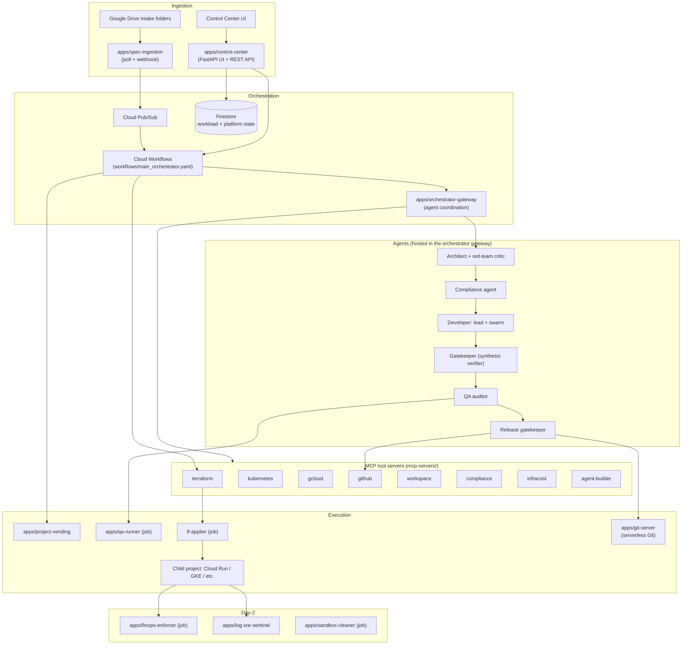

# StackVend Architecture

StackVend is an event-driven set of Cloud Run services and jobs, orchestrated by Google Cloud Workflows, that combine LLM agents, Model Context Protocol (MCP) tool servers and deterministic execution engines.

> **Public preview.** This document describes the current design. Several subsystems (notably the IaC validation and repair logic) are being reworked; see [Platform Internals](platform-internals.md). Where this document and the code disagree, the code wins.
>
> **Naming.** Internal resource names (Cloud Run services, service accounts, buckets, secrets, Cloud Scheduler jobs) use the historical `castor-` prefix in several places. Names shown below are the real ones.

---

## 1. System topology



---

## 2. Services and jobs

Cloud Run **services** (defined in `infra/platform/main.tf`, deployed from source by `scripts/deploy-services.sh`):

| Cloud Run service | Source | Role |
| :--- | :--- | :--- |
| `product-control-center-ui` | `apps/control-center` | Web UI and REST API: workload catalog, Flight Deck telemetry, approvals, platform settings, the conversational assistant. |
| `orchestrator-gateway-service` | `apps/orchestrator-gateway` | Bridge between Cloud Workflows and the LLM agents (architect, compliance, developer, gatekeeper, QA auditor, release gatekeeper). |
| `project-repo-vending-service` | `apps/project-vending` | Creates child Google Cloud projects, links billing, creates service accounts, sets up Workload Identity Federation and repositories. |
| `spec-ingestion-service` | `apps/spec-ingestion` | Polls Google Drive intake folders (and accepts webhooks) and publishes intake events. |
| `log-sre-sentinel-service` | `apps/log-sre-sentinel` | Consumes error events from Cloud Logging via Pub/Sub, fingerprints and de-duplicates them, and can start a remediation workflow. |
| `castor-git-server` | `apps/git-server` | Optional serverless Git provider backed by a Cloud Storage bucket. |
| `mcp-terraform-server` | `mcp-servers/terraform` | OpenTofu/Terraform plan/apply/validate with remote state and locking. |
| `mcp-kubernetes-server` | `mcp-servers/kubernetes` | GKE manifest apply, status, logs, events, rollout restart and scaling. |
| `mcp-gcloud-server` | `mcp-servers/gcloud` | Scoped Google Cloud inspection and operations. |
| `mcp-github-toolserver` | `mcp-servers/github` | Branches, commits, diffs, pull requests and merges. |
| `mcp-workspace-connector` | `mcp-servers/workspace` | Reads Google Docs and moves specs between Drive status folders. Creates the incident document for an SRE remediation run (`/create-incident-spec`) in the in-progress folder (`IN_PROGRESS_FOLDER_ID`); without that folder it answers 503 and the run continues without a document. |
| `mcp-infracost-server` | `mcp-servers/infracost` | Rough pre-flight cost estimation of plans. |
| `mcp-compliance-server` | `mcp-servers/compliance` | Organization-policy harvesting and policy inspection (REST only). |
| `mcp-agent-builder-server` | `mcp-servers/agent-builder` | Scaffolding and deployment helpers for Google ADK / Agent Engine solutions. |

Cloud Run **jobs**:

| Cloud Run job | Source | Role |
| :--- | :--- | :--- |
| `qa-sandbox-test-runner` | `apps/qa-runner` | Runs generated tests, linters and security scans in an ephemeral sandbox. |
| `github-refactor-scanner-job` | `apps/refactor-scanner` | Scheduled code-scan job (being reworked). |
| `finops-budget-enforcer-job` | `apps/finops-enforcer` | Applies budget-breach policies. |
| `infra-rollback-job` | `apps/infra-rollback` | Restores previous Terraform state versions. |
| `sandbox-garbage-collector-job` | `apps/sandbox-cleaner` | Asks project vending to expire ephemeral resources whose time is up (vending does not run these expiries yet; see [Workload Lifecycle](workload-lifecycle.md#5-safeguards-during-decommissioning)). |
| `sre-telemetry-digest-job` | `apps/sre-digest` | Weekly error clustering and latency digest. |
| `finops-spend-sync-job` | `apps/finops-spend-sync` | Nightly spend and run-rate sync of every workload into Firestore. |
| `sandbox-workload-sweeper-job` | `apps/sandbox-sweeper` | Daily sandbox expiry notices; asks project vending to delete expired sandboxes. |
| `billing-alert-drain-job` | `apps/billing-alert-drain` | Reads budget alerts every 30 minutes; records spend and applies the workload's breach policy through `finops-budget-enforcer-job`. |

The `tf-applier` job is built from `mcp-servers/terraform` (`applier.py`) and is the process that actually runs `tofu apply` against child projects.

Supporting resources created by the platform Terraform include a Firestore database, Pub/Sub topics (with a dead-letter topic), Secret Manager secrets, an Artifact Registry repository (`castor-docker-repo`), a Terraform state bucket (`castor-tfstate-<project-id>`), a Git storage bucket (`castor-git-repos-<project-id>`), Cloud Scheduler jobs, and a set of platform service accounts (`sa-castor-*`, plus `sa-project-provisioner`).

---

## 3. MCP tool servers

The `mcp-servers/*` services are small FastAPI applications. Each exposes `GET /health`. Most also expose a JSON-RPC 2.0 endpoint at `POST /mcp` (supporting `tools/list` and `tools/call`); the compliance server is REST-only. Most have a set of direct REST endpoints that the orchestration code calls. They are deployed with buildpacks (each has a `Procfile`, no Dockerfile).

* **terraform**: `terraform_plan`, `terraform_apply`, `terraform_drift_check` and `terraform_force_unlock` tools; pre-caches providers, vendors golden modules and bundles, runs `init`/`validate`/`plan`/`apply` with GCS state locking, and contains the apply-time self-healing loop.
* **kubernetes**: applies and inspects manifests on child GKE clusters using short-lived credentials.
* **gcloud**: executes scoped Google Cloud commands and queries (for example Cloud Run status and logs).
* **github**: branch, read-file, commit, diff, pull-request and merge operations.
* **workspace**: reads Google Docs and moves specs between Drive status folders (`01_Inbox_Requests`, `02_In_Progress`, `04_Completed`).
* **compliance**: harvests effective organization policies for a folder or project. It is REST-only (no `/mcp` endpoint).
* **infracost**: produces a rough (heuristic) monthly cost estimate for a proposed plan.
* **agent-builder**: ADK scaffolding, datastore provisioning, evaluation runs and Agent Engine deployment.

The `tf-applier` job and the Terraform MCP container do not ship the `gcloud` or `kubectl` binaries; code running there talks to Google Cloud over REST with authorized sessions.

---

## 4. Agent pipeline

```
[Spec intake: UI / upload / Drive]
        |
        v
  Pre-discovery: organization policies, regional quotas
        |
        v
  Dual-architect consensus
     architect  <--critique-->  red-team critic
     (one bounded remediation turn if the critic finds a critical issue)
     output: architecture doc + 7-step sequenced build plan (task DAG)
        |
        v
  Advisory compliance review -> FinOps cost estimate -> optional plan approval
        |
        v
  Quota feasibility check -> project vending (child project + repository)
        |
        v
  Developer
     SOLO_FAST_PATH               small change to an existing repo
     STANDARD / ENTERPRISE_SWARM  lead developer + specialist juniors in waves
        |
        v
  Preflight validation + synthesis verifier (deterministic, pre-commit)
        |
        v
  QA: sandboxed tests + security scan; security and spec-adherence review
        |
        v
  Release: pull request; human approval when policy requires it
        |
        v
  OpenTofu/Terraform apply (+ Kubernetes manifests for GKE workloads)
```

Fast path: if a workload already has valid infrastructure code merged on `main` (for example when retrying a failed deployment), the workflow can run in `DEPLOY_ONLY` mode, which skips code generation and goes straight to infrastructure deployment.

---

## 5. Security and isolation model

* **Project isolation.** Every workload is deployed into its own child Google Cloud project, giving it a separate IAM policy, quota, VPC and billing attribution.
* **Keyless CI/CD for workloads.** Each child project gets a Workload Identity Pool and provider (`castor-gh-pool`) and a deployer service account (`sa-gh-deployer`) that only the workload's own GitHub repository can impersonate: the provider accepts only that repository's `main` branch, and, once vending has recorded the repository's numeric GitHub id, only a token carrying that id, so a repository deleted and re-created under the same name cannot deploy.
* **Spec intake publishers.** Only the spec-ingestion service's runtime identity, the Control Center and the SRE remediation workflow can publish to the `spec-intake-events` topic; every platform Pub/Sub publisher holds its role on its own topic, never on the whole host project.
* **Buildpacks, no Dockerfiles.** Generated workloads are built with Cloud Native Buildpacks; the preflight stage rejects Dockerfiles.
* **Ingress options.** The platform can be installed in an authenticated mode (Google Identity-Aware Proxy in front of the Control Center, with Firestore-backed roles `ADMIN`, `WORKLOAD_MANAGER` and `VIEWER`) or in a public sandbox mode intended only for short-lived evaluation. See the [Quickstart](quickstart.md).
* **Only the Control Center is public.** Every other host service (the orchestrator gateway, project vending, the MCP tool servers, the SRE sentinel, spec ingestion and the Serverless Git server) accepts internal traffic only once `host_internal_ingress` is on (new installs: from the installer's first apply). Their callers are same-project Pub/Sub push, Cloud Scheduler and Workflows, which count as internal, and the platform's own services and jobs, which reach them through the platform network `stackvend-host` (`host_vpc_egress`, `infra/platform/host_network.tf`): by default Direct VPC egress for `*.run.app` only, a private `run.app` DNS zone and a Private Service Connect endpoint for Google APIs, while other outbound traffic (GitHub, the OpenTofu registry, Google APIs) keeps Cloud Run's default path; `host_egress_mode = "NAT_ALL_TRAFFIC"` sends all traffic through the network and Cloud NAT instead. IAM is still checked on every request. The QA sandbox job, which runs generated code, is never on that network. See [Configuration: Platform network](configuration.md#platform-network-internal-only-host-services).
* **Host project protection.** Decommission and sweep operations refuse to act on the platform's own host project.
* **Open-source IaC default.** The default engine is OpenTofu; HashiCorp Terraform is supported as an alternative.
* **Trust model.** LLM output and uploaded specifications are untrusted input. Deterministic validation and human approval gates sit between generated content and cloud mutations, but the preview has known gaps that are being addressed; do not run it with credentials or data you cannot afford to lose, and review generated infrastructure before it is applied. Who may change a workload's Terraform, and what the Terraform runner can read, is described in [Known limitations: Trust model](known-limitations.md#trust-model-who-may-change-a-workloads-terraform).
