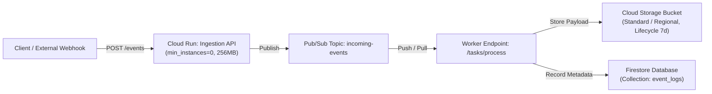

# Test Workload Plan 01: Ephemeral Webhook & Async Pub/Sub Event Router

## 1. Executive Summary & Objective
* **Product ID**: `test-01-event-router`
* **Complexity Level**: Tier 1 (Baseline / Low-Cost)
* **Estimated Monthly Spend**: < $1.00 (100% Free Tier Eligible)
* **Lifespan**: 30-Day Sandbox Workload (`is_sandbox: true`, `sandbox_ttl_days: 30`)
* **Primary Objective**: Test the base StackVend pipeline: single Cloud Run deployment, Pub/Sub topic and subscription vending, Cloud Storage bucket provisioning, and Firestore document writes.

### 📝 Workload Form Submission Prompt (Copy & Paste)
> Please deploy a lightweight, serverless webhook ingestion and asynchronous event routing service on Google Cloud Run. The system must expose a public `POST /api/v1/events` endpoint that validates incoming JSON payloads containing `event_type`, `source_system`, `payload`, and `timestamp`, and publishes valid messages to a Cloud Pub/Sub topic named `test-events-inbound`. Include a `GET /health` endpoint reporting system health, service name, and IaC engine.
>
> Provision an internal worker endpoint `POST /api/v1/tasks/process` invoked via Pub/Sub push subscription that persists raw JSON payloads to a regional Google Cloud Storage bucket with a 7-day auto-deletion lifecycle rule, and writes indexed audit records to a Firestore collection named `event_audit_records`. Enforce scale-to-zero compute (min instances = 0) with a maximum of 3 instances, zero manual Dockerfiles (rely exclusively on Google Cloud Native Buildpacks), and 100% pytest test coverage.

---

## 2. Infrastructure Architecture & Cheap Cost Profile

### Cost-Optimized GCP Resources:
1. **Google Cloud Run**:
   * CPU: `0.5 vCPU`, Memory: `256 MiB`
   * `min_instances = 0` (scales to zero when idle; $0.00 idle cost).
   * `max_instances = 3`
2. **Cloud Pub/Sub**:
   * Topic: `test-events-inbound`
   * Subscription: `test-events-worker-sub` (Ack deadline: 30s)
3. **Google Cloud Storage**:
   * Regional bucket (`us-central1`), standard storage class.
   * Auto-deletion lifecycle rule: `age: 7 days`.
4. **Google Cloud Firestore**:
   * Native mode collection: `event_audit_records`.

---

## 3. Application Specification & Acceptance Criteria

### Endpoints:
* `GET /health`: Returns `{"status": "healthy", "service": "event-router", "engine": "OpenTofu"}`.
* `POST /api/v1/events`:
  * Validates JSON payload (`event_type`, `source_system`, `payload`, `timestamp`).
  * Emits event to Pub/Sub topic with message attributes.
  * Returns `202 Accepted` with `trace_id` and Pub/Sub `message_id`.
* `POST /api/v1/tasks/process`:
  * Internal Pub/Sub worker subscriber endpoint.
  * Dumps raw JSON payload to Cloud Storage: `gs://[bucket]/events/{year}/{month}/{event_id}.json`.
  * Writes indexed document to Firestore `event_audit_records`.

### Testing & QA Requirements:
* 100% Pytest test coverage across FastAPI route handlers and Pub/Sub mock publisher.
* Zero manual `Dockerfile` (Buildpacks compliance verified).
* Clean AST syntax and Bandit security checks (zero Sev-1/Sev-2 issues).
