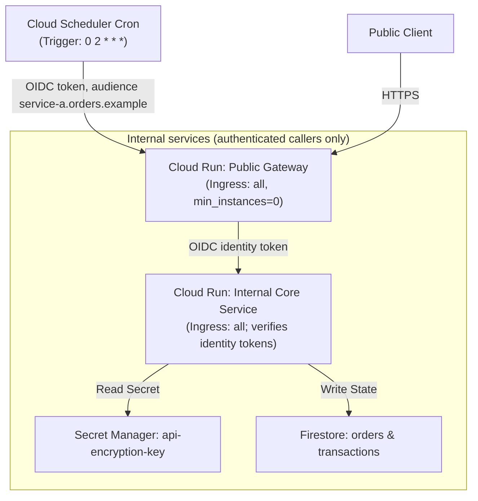

# Test Workload Plan 02: Multi-Service Cloud Run Mesh with an Authenticated Internal Service & Cloud Scheduler

## 1. Executive Summary & Objective
* **Product ID**: `test-02-multi-cloudrun-mesh`
* **Complexity Level**: Tier 2 (Multi-Service Microservices Mesh)
* **Estimated Monthly Spend**: ~$2.00 - $4.00 (Scaled-to-zero compute)
* **Lifespan**: 30-Day Sandbox Workload (`is_sandbox: true`, `sandbox_ttl_days: 30`)
* **Primary Objective**: Test multi-service synthesis in Cloud Run: deploying two interdependent Cloud Run microservices (Public Gateway + Internal Core Service that accepts authenticated callers only), Serverless VPC egress, Secret Manager integration, and Cloud Scheduler triggers.

### 📝 Workload Form Submission Prompt (Copy & Paste)
> Please deploy a multi-service Cloud Run microservices mesh consisting of a Public API Gateway (Service A) and an Internal Core Processing Service (Service B). The Public Gateway must expose public HTTPS endpoints (`GET /health` and `POST /api/v1/orders`), validate order requests, acquire a Google Cloud IAM OIDC identity token with the fixed audience `https://service-b.orders.example` (a constant in both services, not a URL that is called), and securely forward validated requests to Service B's URL with that token.
>
> The Internal Core Service must accept authenticated callers only: every request to its `/internal/` routes must carry a valid Google-signed OIDC identity token, which Service B must verify itself, answering anything else with HTTP 401 or 403. Both services run as the same workload service account, so Service B must also check that the token's email is its own service account, read from the metadata server on the first request (not at import time). Service B must accept only the exact audience `https://service-b.orders.example` and must never use the `Host` header or any other request field to decide it. Service B must also retrieve an API encryption key from Google Secret Manager (`order-signing-secret`), generate a cryptographic transaction digest, and write order transaction records to Firestore. Additionally, provision a Cloud Scheduler job triggering daily order reconciliation at 2:00 AM UTC (`0 2 * * *`) by calling the Gateway's `POST /api/v1/reconcile` with a Google-signed OIDC identity token: the job's `oidc_token` uses the workload service account as `service_account_email` and sets `oidc_token.audience` to the fixed audience `https://service-a.orders.example` (a constant in Service A and the Scheduler job, not a URL that is called). Service A must verify that token itself on its reconcile route before doing anything else (Google signature, exactly that audience, and a token email equal to the workload service account, read from the metadata server on the first request, not at import time), answering anything else with HTTP 401 or 403. Ensure both services scale to zero when idle and include comprehensive pytest test coverage with mock OIDC authentication and a mocked metadata server, including the reconcile route refusing a missing token, a wrong audience and a wrong email.

---

## 2. Infrastructure Architecture & Cheap Cost Profile

### Cost-Optimized GCP Resources:
1. **Cloud Run Service A (Public Gateway)**:
   * CPU: `1 vCPU`, Memory: `256 MiB`, `min_instances = 0`, `max_instances = 3`
   * Ingress: `all` (Public API with Google IAM or API token validation).
2. **Cloud Run Service B (Internal Core Service)**:
   * CPU: `1 vCPU`, Memory: `512 MiB`, `min_instances = 0`, `max_instances = 2`
   * Ingress: `all`. This release cannot make a single Cloud Run service unreachable from the internet (see [Known limitations](../known-limitations.md#cloud-run-services-cannot-be-made-internal-only-yet)); Service B is protected by caller authentication, not by the network.
   * Authentication: every `/internal/` request needs a valid Google-signed OIDC identity token with the fixed audience `https://service-b.orders.example`, from the workload's service account (verified in the service; anything else gets HTTP 401 or 403).
3. **Google Secret Manager**:
   * Single secret: `order-signing-secret` (Free tier: 6 active secret versions).
4. **Cloud Scheduler**:
   * Schedule: `0 2 * * *` (Daily reconciliation run). Target: Service A `/api/v1/reconcile`.
   * Authentication: `oidc_token` with `service_account_email` = the workload service account and `audience` = `https://service-a.orders.example` (set explicitly; without it the token's audience would be the target URL).

---

## 3. Application Specification & Acceptance Criteria

### How Service B is protected in this release
Service B is protected by caller authentication: only a caller with a valid Google-signed OIDC identity token with the audience `https://service-b.orders.example` gets a response from `/internal/` routes. That audience is a constant shared by the two services, not an address anything calls. Nothing blocks the network path.

Both services run as one workload service account, so the token check proves "a caller from this workload", not "only Service A".

Choose **Public** under **Who may use this app** for this example. Cloud Run's own IAM check (`roles/run.invoker`) is set for the whole workload by that choice, not per service, so a private choice would also close the gateway to public clients. This example has not been verified with the private choices.

### Service A (Public Gateway):
* `GET /health`: Returns Gateway health and downstream connectivity status.
* `POST /api/v1/orders`:
  * Validates order payload.
  * Fetches a GCP OIDC identity token with the fixed audience `https://service-b.orders.example`.
  * Forwards the request to Service B's URL over HTTPS with the identity token in the `Authorization: Bearer` header.
  * Returns combined execution payload to client.
* `POST /api/v1/reconcile` (called by Cloud Scheduler):
  * Verifies the Scheduler's Google-signed OIDC identity token first (Google signature, the exact fixed audience `https://service-a.orders.example`, a token email equal to the workload's service account) and answers anything else with HTTP 401 or 403. Service A is public, so this check is the only thing that keeps other callers off this route.
  * Then forwards the reconciliation to Service B with its own identity token (audience `https://service-b.orders.example`).

### Service B (Internal Processing Engine):
* `GET /health`: Returns internal engine readiness.
* `POST /internal/process-order`:
  * Verifies the caller's identity token (Google signature, the exact fixed audience, the workload's service account) and answers anything else with HTTP 401 or 403.
  * Fetches encryption key from Secret Manager.
  * Generates cryptographic transaction digest and persists order to Firestore.

### Testing & QA Requirements:
* Verification of both services in a single OpenTofu manifest bundle.
* Pytest mocking cross-service OIDC token generation and Secret Manager client.
* Pytest proving `POST /api/v1/reconcile` answers HTTP 401 or 403 without a token, with a wrong audience and with a wrong email, and forwards only with a valid Scheduler token.
* Bandit and AST compliance on both service source trees.
