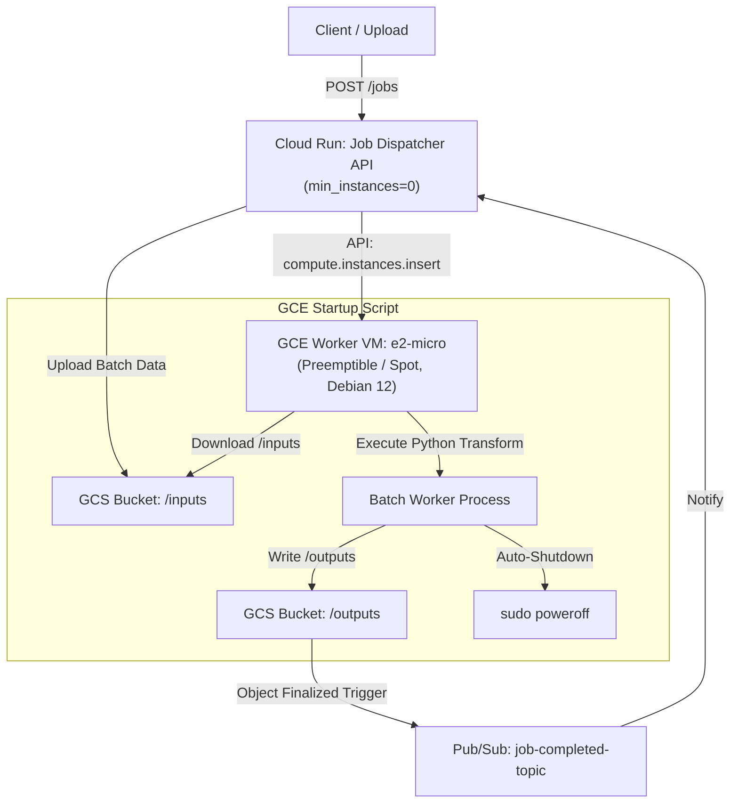

# Test Workload Plan 03: Hybrid Compute — Cloud Run API + Ephemeral GCE Worker (e2-micro)

## 1. Executive Summary & Objective
* **Product ID**: `test-03-hybrid-gce-worker`
* **Complexity Level**: Tier 3 (Hybrid Serverless & Virtual Machine Compute)
* **Estimated Monthly Spend**: ~$3.00 - $6.00 (e2-micro machine type / Spot execution)
* **Lifespan**: 30-Day Sandbox Workload (`is_sandbox: true`, `sandbox_ttl_days: 30`)
* **Primary Objective**: Test StackVend's ability to orchestrate hybrid compute environments: deploying a Cloud Run REST control plane alongside a Google Compute Engine (GCE) VM worker using cheap `e2-micro` instances with automated startup-scripts and GCS pipeline data handoff.

### 📝 Workload Form Submission Prompt (Copy & Paste)
> Please deploy a hybrid serverless and virtual machine batch processing system. The architecture requires a Cloud Run API Dispatcher service (`min_instances = 0`) that exposes `POST /api/v1/jobs` and `GET /api/v1/jobs/{job_id}`. When a client submits batch data, the Cloud Run service stages the raw input payload into a dedicated Google Cloud Storage bucket (`/inputs`) and programmatically provisions an ephemeral Google Compute Engine (GCE) VM instance.
>
> The GCE worker must use a cost-optimized `e2-micro` Spot/Preemptible instance running Debian 12 minimal with a standard 10 GB persistent disk. The VM must execute an automated startup script (`metadata_startup_script`) that downloads the staged dataset from GCS, runs a Python data transformation pipeline generating checksums and statistical aggregates, writes the summarized report to a secondary GCS bucket (`/outputs`), and immediately executes `sudo poweroff` upon completion to prevent runaway compute costs. Include a Pub/Sub completion notification topic and comprehensive pytest unit tests mocking compute API calls.

---

## 2. Infrastructure Architecture & Cheap Cost Profile

### Cost-Optimized GCP Resources:
1. **Google Compute Engine (GCE) Worker**:
   * Instance Type: **`e2-micro`** (2 vCPUs, 1 GB RAM — part of GCP Free Tier).
   * Provisioning Model: **`SPOT`** (reduces cost by 60–90%).
   * Disk: `10 GB` Standard Persistent Disk (`pd-standard`).
   * OS: Debian 12 minimal.
   * `metadata_startup_script`: Downloads worker script, runs transformation on staged GCS files, and triggers self-shutdown (`sudo poweroff`).
2. **Google Cloud Run (API Dispatcher)**:
   * CPU: `1 vCPU`, Memory: `256 MiB`, `min_instances = 0`.
3. **Google Cloud Storage**:
   * Two regional buckets: `test-gce-batch-inputs-[hash]` and `test-gce-batch-outputs-[hash]`.
4. **IAM & Networking**:
   * Minimal default VPC subnet with Private Google Access enabled.
   * Scoped Service Account with `roles/storage.objectAdmin` and `roles/compute.instanceAdmin.v1`.

---

## 3. Application Specification & Acceptance Criteria

### Cloud Run Dispatcher Service:
* `POST /api/v1/jobs`:
  * Receives CSV or JSON data chunk from client.
  * Stages input file in `gs://test-gce-batch-inputs/`.
  * Generates an ephemeral GCE `e2-micro` VM with a custom startup script.
  * Returns `job_id`, VM instance name, and initial status `PROVISIONING`.
* `GET /api/v1/jobs/{job_id}`:
  * Inspects output bucket for result payload and returns job status (`RUNNING`, `COMPLETED`, `FAILED`).

### GCE Startup Script Execution:
* Fetches the staged data file from GCS.
* Computes analytical aggregates (record count, checksums, statistical summary).
* Writes output report to `gs://test-gce-batch-outputs/{job_id}_summary.json`.
* Calls `sudo poweroff` to terminate the VM immediately upon completion to avoid running up compute charges.

### Testing & QA Requirements:
* OpenTofu manifest testing for `google_compute_instance` with `metadata_startup_script`.
* Pytest mocking Google Compute API `instances().insert()` and GCS blob storage.
* Deterministic QA validation verifying firewall egress rules and least-privilege IAM bindings.
