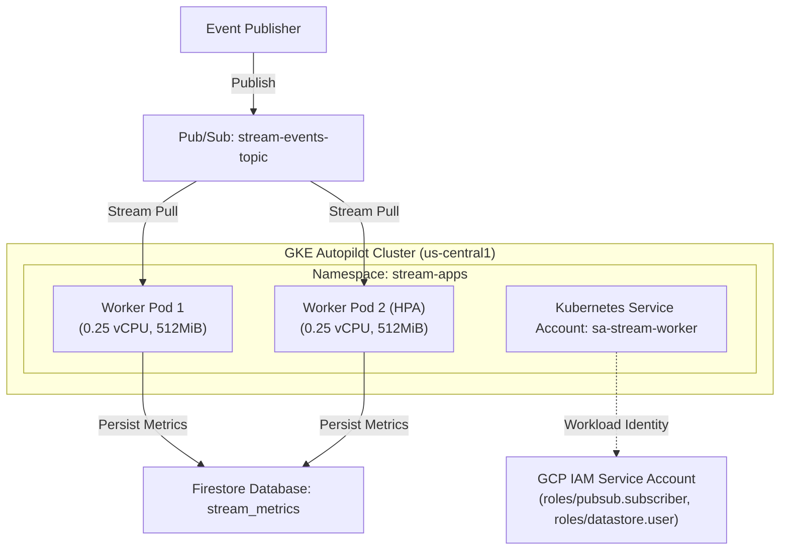

# Test Workload Plan 04: Micro-GKE Autopilot Stream Processing Cluster

## 1. Executive Summary & Objective
* **Product ID**: `test-04-gke-stream-processor`
* **Complexity Level**: Tier 4 (Containerized Kubernetes Orchestration)
* **Estimated Monthly Spend**: ~$5.00 - $10.00 (Autopilot per-pod billing + GCP cluster management credit)
* **Lifespan**: 30-Day Sandbox Workload (`is_sandbox: true`, `sandbox_ttl_days: 30`)
* **Primary Objective**: Test StackVend's Kubernetes provisioning engine: deploying a compact GKE Autopilot cluster, configuring Workload Identity Federation (KSA $\rightarrow$ GSA), building images to Artifact Registry, and running a multi-pod stream processing deployment consuming from Cloud Pub/Sub.

### 📝 Workload Form Submission Prompt (Copy & Paste)
> Please provision a containerized stream processing workload on Google Kubernetes Engine (GKE) Autopilot in `us-central1`. The infrastructure should configure an Artifact Registry Docker repository and a GKE Autopilot cluster with Google Cloud Workload Identity Federation enabled, mapping a Kubernetes Service Account (`sa-stream-worker`) in the `stream-apps` namespace directly to a Google Cloud IAM Service Account with least-privilege permissions (`roles/pubsub.subscriber`, `roles/datastore.user`) and zero static secret keys.
>
> Deploy a Python asyncio streaming worker application packaged via Cloud Native Buildpacks that subscribes to a Cloud Pub/Sub pull subscription (`stream-gke-sub`), consumes streaming batches of up to 50 events concurrently, computes throughput and message latency aggregates over 1-minute tumbling windows, and writes time-series metrics to Firestore (`stream_metrics`). Define Kubernetes manifests including a Deployment with 1 replica (`cpu: 250m`, `memory: 512Mi`), HTTP liveness/readiness health probes, and a HorizontalPodAutoscaler scaling up to 2 pods at 80% CPU utilization.

---

## 2. Infrastructure Architecture & Cheap Cost Profile

### Cost-Optimized GCP Resources:
1. **Google Kubernetes Engine (GKE) Autopilot**:
   * Mode: **Autopilot** (Google handles node management, OS patching, and scaling; you only pay for pod requests by second).
   * Note on Cost: Google Cloud provides a **$74.40/month cluster management fee credit** per billing account, making one Autopilot cluster free of cluster management charges.
2. **Kubernetes Pod Resource Sizing**:
   * Requests: `cpu: 250m`, `memory: 512Mi` (GKE Autopilot minimum threshold).
   * Replicas: `1` (autoscaling up to max `2` via HorizontalPodAutoscaler).
3. **Artifact Registry**:
   * Standard Docker repository: `us-central1-docker.pkg.dev/[PROJECT_ID]/stream-workloads`.
4. **Workload Identity Federation**:
   * Connects Kubernetes Service Account (`sa-stream-worker`) directly to Google IAM Service Account with zero stored secret keys.
5. **Cloud Pub/Sub**:
   * Topic: `stream-ingest-topic`
   * Subscription: `stream-gke-sub` (Pull subscription, max delivery attempts: 5).

---

## 3. Application Specification & Acceptance Criteria

### Stream Worker Application (Python Asyncio):
* Uses official `google-cloud-pubsub` async subscriber client.
* Authenticates automatically via Workload Identity (GCP metadata server).
* Concurrently consumes batches of 50 messages from `stream-gke-sub`.
* Aggregates streaming metrics (throughput, error rates, message latency) over 1-minute tumbling windows.
* Writes window summaries to Firestore collection `stream_metrics`.

### Kubernetes Manifests (Synthesized by StackVend):
* `Namespace`: `stream-apps`
* `ServiceAccount`: `sa-stream-worker` with GCP Workload Identity annotation.
* `Deployment`: `stream-processor-deployment` (1 replica, rolling update strategy, liveness & readiness HTTP probes).
* `HorizontalPodAutoscaler`: Scaled on CPU utilization target 80% (max 2 replicas).

### Testing & QA Requirements:
* OpenTofu `google_container_cluster` (Autopilot enabled) and `kubernetes_manifest` synthesis.
* Pytest mocking Pub/Sub streaming pull and Firestore client with 100% pass rate.
* AST syntax and Bandit security checks (zero Sev-1/Sev-2 issues).
