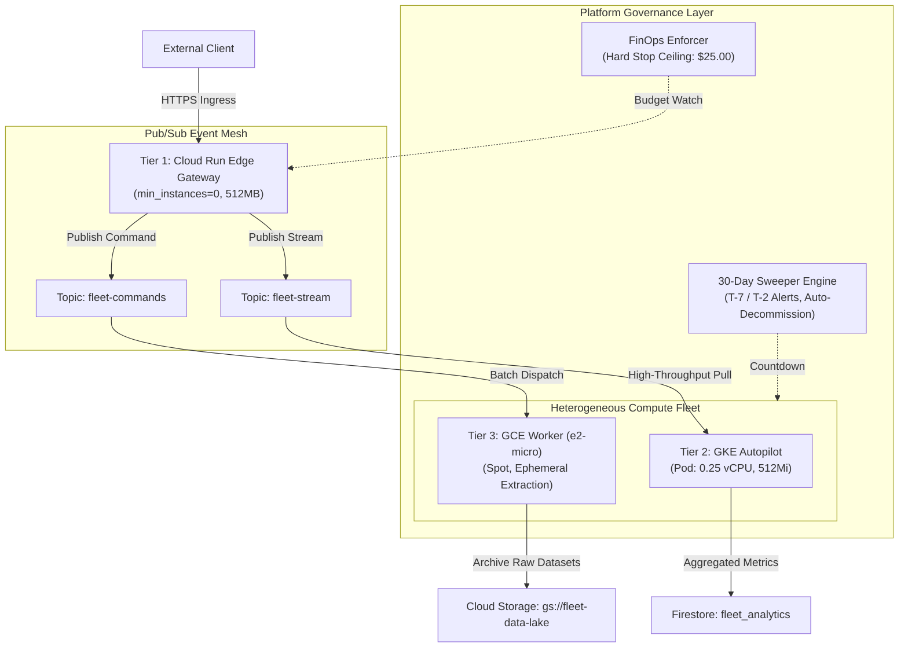

# Test Workload Plan 05: Omni-Platform Distributed Fleet (Cloud Run + GKE + GCE + FinOps & 30d Lifecycle)

## 1. Executive Summary & Objective
* **Product ID**: `test-05-omni-fleet`
* **Complexity Level**: Tier 5 (Maximum Complexity / Enterprise Distributed Architecture)
* **Estimated Monthly Spend**: ~$10.00 - $18.00 (Governed by strict $25.00 FinOps ceiling)
* **Lifespan**: 30-Day Sandbox Workload (`is_sandbox: true`, `sandbox_ttl_days: 30`)
* **Primary Objective**: The ultimate comprehensive stress-test of StackVend's end-to-end orchestration: synthesizing a multi-tier hybrid architecture (Cloud Run Edge API + GKE Autopilot Processing + GCE e2-micro Worker + Pub/Sub Event Mesh), governed by real-time FinOps budget enforcement ($25 cap) and the 30-Day Autonomous Sandbox Lifecycle Engine.

### 📝 Workload Form Submission Prompt (Copy & Paste)
> Please deploy a multi-tier distributed fleet architecture incorporating Cloud Run, GKE Autopilot, and an ephemeral Compute Engine worker. Tier 1 must consist of a Cloud Run Edge Gateway (`min_instances = 0`, 512 MiB) exposing `POST /api/v1/dispatch` to accept incoming client jobs and route commands across a Pub/Sub event mesh (`fleet-commands` for batch operations and `fleet-stream` for real-time telemetry), along with a `GET /api/v1/fleet/status` health dashboard.
>
> Tier 2 must provision a GKE Autopilot pod (`0.25 vCPU`, `512 MiB`) pulling continuous streaming metrics from `fleet-stream` via Workload Identity and writing rolling time-series aggregates to Firestore (`fleet_analytics`). Tier 3 must coordinate on-demand ephemeral `e2-micro` Spot VM workers that process heavy staged datasets from Google Cloud Storage, write result manifests back to GCS, and immediately power off. Enforce a strict FinOps monthly budget ceiling of $25.00 with alerts at 50% and 80%, deploy as a 30-Day Sandbox Workload with automatic lifecycle tracking, and verify 100% pytest test coverage across all three compute tiers.

---

## 2. Infrastructure Architecture & Multi-Tier Topology

### Cost-Optimized Resource Sizing across all Tiers:
1. **Tier 1 (Cloud Run Edge Gateway)**:
   * `1 vCPU`, `512 MiB`, `min_instances = 0`, `max_instances = 3`.
   * Serves public REST API, validates tokens, routes commands to Pub/Sub.
2. **Tier 2 (GKE Autopilot Container Processing)**:
   * 1 Autopilot Pod: `0.25 vCPU`, `512 MiB`.
   * Autoscaling max 2 replicas.
   * Consumes continuous streaming traffic using Workload Identity.
3. **Tier 3 (GCE e2-micro Batch Worker)**:
   * **`e2-micro`** Spot VM (GCP Free Tier machine family).
   * 10 GB standard persistent disk.
   * Auto-shuts down after executing scheduled data transformations.
4. **Cloud Pub/Sub**:
   * Dual topics: `fleet-commands` (control plane) and `fleet-stream` (data plane).
5. **Storage & State**:
   * GCS bucket with 7-day auto-delete lifecycle policy.
   * Firestore multi-tenant collections: `fleet_workloads`, `fleet_analytics`.
6. **FinOps & Lifecycle Policy**:
   * **Budget Ceiling**: `$25.00 / month` with automated alerting at 50% ($12.50) and 80% ($20.00).
   * **Lifecycle**: `is_sandbox: true`, initial lifespan `30 days`. Tested with operator controls (`Extend +30d`, `Promote to Production`).

---

## 3. Application Specification & Acceptance Criteria

### Component 1: Cloud Run Edge Gateway
* `POST /api/v1/dispatch`: Accepts client jobs, determines routing strategy (streaming vs. heavy batch), and publishes to appropriate Pub/Sub topic.
* `GET /api/v1/fleet/status`: Aggregates real-time health from GKE pods, GCE worker state, and current billing spend.

### Component 2: GKE Stream Processor (Fast Stream Analytics)
* Reads micro-batches from `fleet-stream`.
* Computes real-time rolling aggregates and writes time-series metrics to Firestore.

### Component 3: GCE Spot Worker (Heavy File Transformations)
* Triggered on demand via compute API.
* Pulls raw input payloads from Cloud Storage, applies compression/checksum validation, writes results back to GCS, and calls `sudo poweroff`.

### Component 4: Full Platform Governance Verification
* **FinOps Enforcement**: Verifies that `apps/finops-enforcer` correctly records budget quotas for this child project.
* **30-Day Sweeper**: Verifies that the workload appears on the Control Center dashboard with a countdown badge (`🧪 Sandbox (30.0d)`), appears in the `🧪 Sandboxes` catalog filter, and correctly triggers T-7 and T-2 notifications.

---

## 4. Verification & QA Matrix

* **Multi-Module OpenTofu Synthesis**: Validates that StackVend synthesizes valid HCL2 covering `google_cloud_run_v2_service`, `google_container_cluster`, `google_compute_instance`, `google_pubsub_topic`, and `google_storage_bucket` without resource conflicts.
* **Deterministic QA Gates**: 100% Pytest pass rate across all three application layers, zero manual Dockerfiles (Buildpacks only), clean AST trees, and zero Bandit Sev-1/Sev-2 vulnerabilities.
* **Dual-Lens Audit**: Lens A security evaluation verifying zero open database ports and least-privilege IAM; Lens B verifying every Task DAG acceptance criterion is implemented (no missed directive).
