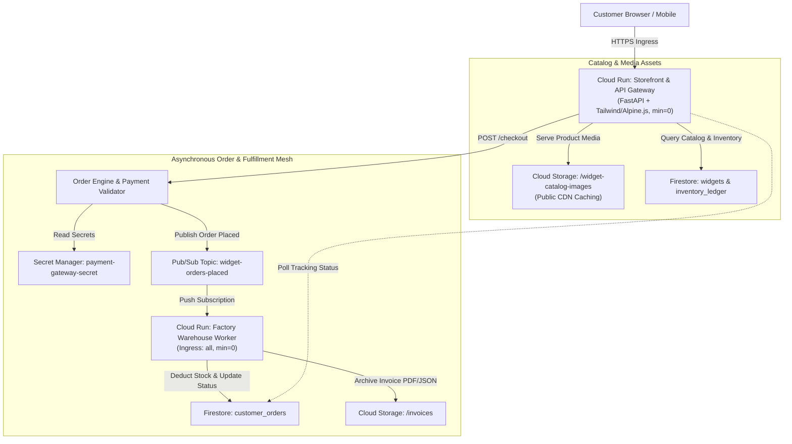

# Test Workload Plan 06: Full-Stack E-Commerce Platform for a Widget Factory

## 1. Executive Summary & Objective
* **Product ID**: `test-06-widget-factory-ecommerce`
* **Complexity Level**: Tier 6 (Full-Stack Real-World Commercial Application)
* **Estimated Monthly Spend**: ~$3.00 - $8.00 (100% Serverless, Scaled-to-Zero Compute)
* **Lifespan**: 30-Day Sandbox Workload (`is_sandbox: true`, `sandbox_ttl_days: 30`)
* **Primary Objective**: Test StackVend's capability to deliver a complete, customer-facing business application from scratch: an industrial **Widget Factory E-Commerce Platform** featuring a dynamic product catalog, interactive custom widget configurator, shopping cart, checkout pipeline, async factory fulfillment queue, and real-time order tracking.

### 📝 Workload Form Submission Prompt (Copy & Paste)
> Please build a complete full-stack e-commerce web platform for an industrial custom widget manufacturing company. The system must feature a public-facing Storefront and API Gateway hosted on Google Cloud Run (`min_instances = 0`) built with FastAPI and an embedded modern frontend (Tailwind CSS and Alpine.js). The storefront must feature an interactive custom widget configurator allowing buyers to select materials (Titanium, Brass, Steel, Polymer), bore dimensions, and finishes with live client-side price calculation, alongside an inventory-backed catalog and persistent shopping cart.
>
> The backend order processing pipeline must expose `POST /api/v1/orders/checkout`, validate mock payments against a secret in Google Secret Manager, and publish order events to a Cloud Pub/Sub topic (`widget-orders-placed`). Provision an asynchronous Factory Warehouse fulfillment service on Cloud Run (internal ingress) triggered via Pub/Sub push subscription that executes atomic inventory deductions in Firestore (`inventory_ledger`), generates digital invoice manifests stored in Google Cloud Storage (`/invoices`), and updates order status throughout manufacturing. Include a customer order tracking portal (`GET /track/{order_id}`) and pre-populate Firestore with 5 initial manufactured widget SKUs.

---

## 2. Infrastructure Architecture & Topology



---

## 3. Cost-Optimized GCP Resources (Cheap & Scalable)

1. **Storefront & API Gateway (Cloud Run)**:
   * Memory: `512 MiB`, CPU: `1 vCPU`.
   * `min_instances = 0` (scales to zero during downtime; $0 idle cost).
   * Ingress: `all` (Public HTTPS with automatic SSL certificates).
2. **Factory Fulfillment Worker (Cloud Run)**:
   * Memory: `256 MiB`, CPU: `0.5 vCPU`, `min_instances = 0`.
   * Ingress: `all` (invoked by the Pub/Sub push subscription with an OIDC identity token; this release cannot make a single Cloud Run service unreachable from the internet).
3. **Google Cloud Storage**:
   * Bucket A: `widget-factory-media-[hash]` (Public read for widget diagrams & CAD thumbnails).
   * Bucket B: `widget-factory-invoices-[hash]` (Private storage for generated invoices with 30-day lifecycle auto-delete).
4. **Google Cloud Firestore (Native Mode)**:
   * Collections:
     * `widgets`: Catalog of manufactured widgets (SKU, dimensions, material, base price).
     * `inventory_ledger`: Real-time stock counts by factory warehouse location.
     * `customer_orders`: Order state (`PENDING_PAYMENT`, `QUEUED_IN_FACTORY`, `MANUFACTURING`, `SHIPPED`).
5. **Cloud Pub/Sub**:
   * Topic: `widget-orders-placed`
   * Subscription: `factory-fulfillment-push-sub` (Push to internal worker endpoint `/api/v1/factory/process-order`).
6. **Google Secret Manager**:
   * Secret: `widget-factory-stripe-mock-key` (Used to validate mock credit card authorizations).

---

## 4. Application Specification & Feature Matrix

### A. Customer Storefront & Product Customizer (FastAPI + Embedded UI):
* **Widget Catalog (`GET /`)**:
  * Displays industrial widgets with specifications:
    * *Precision Titanium Gear Widget* (SKU: `WDG-TI-01`)
    * *Heavy-Duty Brass Coupling Widget* (SKU: `WDG-BR-02`)
    * *Ultra-Light Carbon Bushing Widget* (SKU: `WDG-CB-03`)
* **Interactive Widget Configurator**:
  * Users can select custom material (Steel, Brass, Titanium, Polymer), bore diameter (mm), and surface finish.
  * Real-time dynamic pricing calculation in the browser.
* **Shopping Cart & Checkout**:
  * Client-side cart persistence via local storage.
  * `POST /api/v1/orders/checkout`: Validates inventory, captures shipping details, authorizes mock payment, generates order confirmation, and publishes to Pub/Sub.

### B. Asynchronous Factory Fulfillment Pipeline:
* `POST /api/v1/factory/process-order` (Worker):
  * Triggered asynchronously by Pub/Sub event.
  * Performs atomic transaction in Firestore to decrement inventory in `inventory_ledger`.
  * Generates digital invoice manifest in `gs://widget-factory-invoices/`.
  * Updates order status to `QUEUED_IN_FACTORY` $\rightarrow$ `MANUFACTURING`.

### C. Real-Time Order Tracking Portal:
* `GET /track/{order_id}`:
  * Customer order status tracking page displaying progress timeline (Order Received $\rightarrow$ Material Sourced $\rightarrow$ Machined $\rightarrow$ Quality Checked $\rightarrow$ Dispatched).

---

## 5. Seed Data & Initial Catalog Setup

Upon deployment, a bootstrap initialization routine pre-populates Firestore with 5 flagship manufactured widgets:
```json
[
  {
    "sku": "WDG-STEEL-100",
    "name": "Standard Industrial Steel Spur Gear",
    "material": "Alloy Steel 4140",
    "base_price_usd": 24.50,
    "stock_quantity": 500,
    "dimensions": "100mm OD x 20mm Bore",
    "lead_time_days": 2
  },
  {
    "sku": "WDG-TITAN-200",
    "name": "High-Tolerance Aerospace Titanium Bracket",
    "material": "Grade 5 Titanium (Ti-6Al-4V)",
    "base_price_usd": 145.00,
    "stock_quantity": 45,
    "dimensions": "75mm x 50mm x 15mm",
    "lead_time_days": 5
  },
  {
    "sku": "WDG-BRASS-300",
    "name": "Corrosion-Resistant Marine Flange",
    "material": "Naval Brass C46400",
    "base_price_usd": 38.00,
    "stock_quantity": 180,
    "dimensions": "120mm OD x 4-Bolt Pattern",
    "lead_time_days": 3
  }
]
```

---

## 6. Testing & QA Verification Gates

* **Unit & Integration Tests (Pytest)**:
  * `test_catalog_listing`: Verifies widget fetching and inventory levels.
  * `test_order_checkout_atomic_decrement`: Tests that order placement correctly decrements stock without race conditions.
  * `test_out_of_stock_rejection`: Ensures orders fail gracefully with `400 Bad Request` if stock is exhausted.
  * `test_fulfillment_worker_pubsub`: Validates subscriber message parsing and status transition.
* **Platform Security & Compliance**:
  * 100% Buildpacks compliance (zero `Dockerfile`).
  * Secret Manager access scoped strictly via IAM service account token.
  * Warehouse worker endpoint: reachable from the internet in this release, because every Cloud Run service of a Public workload is public. The run therefore pauses for plan approval, and the approval card names this service (`ACCESS.INTERNAL_SERVICE_PUBLIC`); the worker's own code must check the push subscription's identity token.
