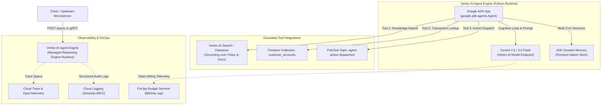

# Test Workload Plan 07: Google ADK Agentic Solution Deployed to Agent Engine

## 1. Executive Summary & Objective
* **Product ID**: `test-07-adk-agent-engine`
* **Complexity Level**: Tier 7 (Autonomous Agentic Architecture / Google ADK + Vertex AI Agent Engine)
* **Estimated Monthly Spend**: ~$1.00 – $4.00 (100% Pay-As-You-Go Token & Serverless Compute; **$0.00 Seat Licensing**)
* **Lifespan**: 30-Day Sandbox Workload (`is_sandbox: true`, `sandbox_ttl_days: 30`)
* **Primary Objective**: Validate StackVend's capability to autonomously synthesize, verify, and deploy a code-first AI agent using the **Google Agent Development Kit (`google-adk`)** natively to **Vertex AI Agent Engine** (`vertexai.agent_engines`), complete with grounding tools, multi-turn session memory, and deterministic QA gatekeeper evaluation—with **zero Gemini Enterprise SaaS license requirements**.

### 📝 Workload Form Submission Prompt (Copy & Paste)
> Please synthesize, verify, and deploy an enterprise agentic AI solution using the Google Agent Development Kit (`google-adk`) hosted natively on Google Cloud Vertex AI Agent Engine (`vertexai.agent_engines`). The agent application must be authored in Python using standard ADK patterns (`google.adk.agents.Agent`) and connect to Gemini 2.5 Flash on Vertex AI. The architecture must run entirely on pay-as-you-go GCP infrastructure services with zero recurring Gemini Enterprise SaaS seat licensing.
>
> Equip the agent with three grounded tools: a Firestore customer account lookup tool (`query_account_status`), a Vertex AI Search knowledge base grounding tool (`search_knowledge_base`), and a Cloud Pub/Sub service ticket action emitter (`create_service_ticket`). Integrate Firestore Native Mode for multi-turn session history and memory (`agent_sessions`). Provide an automated deployment script leveraging `vertexai.agent_engines.create()` with a 7-day lifecycle staging GCS bucket, comprehensive multi-turn conversational unit tests with mock tool contracts, and verify 100% pass rates across deterministic QA gates.

---

## 2. Infrastructure Architecture & Topology



---

## 3. Cost Profile & Licensing Architecture: Zero Gemini Enterprise Licenses

> [!IMPORTANT]
> **Zero SaaS Seat Licenses**:
> This architecture runs entirely on **Google Cloud Platform infrastructure services** (`aiplatform.googleapis.com`, `firestore.googleapis.com`, `pubsub.googleapis.com`).
> * **No Gemini Enterprise licenses** (such as Google Workspace Gemini Enterprise/Business seat subscriptions at $30/user/mo) are purchased, grabbed, or required.
> * Pricing is 100% consumption-based: you pay strictly for the compute minutes of Agent Engine execution and the exact prompt/output tokens processed by Gemini foundational models on Vertex AI.
> * When idle, Agent Engine scales down, costing \$0.00 in idle seat licenses.

### Cost-Optimized GCP Resources:
1. **Vertex AI Agent Engine (`aiplatform.googleapis.com`)**:
   * Fully managed serverless reasoning engine runtime hosting the Python ADK package.
   * Auto-scaling runtime environment; no permanent VM cluster required.
2. **Vertex AI Gemini Foundational Models**:
   * Model: `gemini-2.5-flash` (or `gemini-3.0-flash`).
   * Pay-per-token pricing with zero upfront seat commitment.
3. **Google Cloud Storage (Staging Bucket)**:
   * Bucket: `test-07-adk-staging-[hash]`
   * Holds the zipped ADK Python source distribution and wheel dependencies for Agent Engine initialization.
   * Auto-deletion lifecycle rule: `age: 7 days`.
4. **Google Cloud Firestore (Native Mode)**:
   * Collection `agent_sessions`: Multi-turn conversational memory and turn context.
   * Collection `customer_accounts`: Mock transactional records for tool queries.
5. **Google Cloud Pub/Sub**:
   * Topic: `test-agent-actions`
   * Asynchronous event dispatch when the agent triggers operational actions (e.g., ticket creation).

---

## 4. Application Specification & Acceptance Criteria

### 4.1 ADK Application Structure
The synthesized codebase in the workload repository conforms to the standard Google ADK project specification:

```
test-07-adk-agent-engine/
├── app.py                      # Google ADK App initialization & entrypoint
├── agent.py                    # Root Agent definition, system instructions, and tool bindings
├── tools/
│   ├── __init__.py
│   ├── account_tool.py         # Firestore-backed account query function tool
│   ├── doc_search_tool.py      # Vertex AI Search grounding retrieval tool
│   └── ticket_tool.py          # Pub/Sub action emitter tool
├── deploy.py                   # Script invoking vertexai.agent_engines.create()
├── requirements.txt            # google-adk, google-cloud-aiplatform, pydantic, google-cloud-firestore
└── tests/
    ├── test_agent.py           # Multi-turn conversational unit tests with mock tools
    └── test_tools.py           # Unit tests for individual tool schemas and execution
```

### 4.2 Agent Cognitive Loop & Tool Contracts:
1. **Root Agent Definition (`agent.py`)**:
   * Persona: Enterprise IT & Customer Service Assistant.
   * System Prompt: Strict safety guardrails, anti-jailbreak policies, and forced grounding in retrieved knowledge.
2. **Tools**:
   * `query_account_status(account_id: str) -> dict`: Looks up account status in Firestore.
   * `search_knowledge_base(query: str) -> list[str]`: Retrieves grounded snippets from Vertex AI Search.
   * `create_service_ticket(title: str, severity: str, details: str) -> dict`: Dispatches ticket payload to Pub/Sub.

### 4.3 Deployment & Invocation Contract:
1. **Deployment (`deploy.py`)**:
   ```python
   import vertexai
   from vertexai.agent_engines import create
   from agent import customer_support_agent

   vertexai.init(project=PROJECT_ID, location=REGION)
   agent_engine = create(
       customer_support_agent,
       requirements=[
           "google-adk>=0.1.0",
           "google-cloud-firestore>=2.15.0",
           "pydantic>=2.0.0",
       ],
       display_name="test-07-adk-customer-support",
   )
   ```
2. **Querying**:
   ```python
   response = agent_engine.query(
       message="What is the status of account ACC-1234?",
       session_id="session-user-987",
   )
   ```

### 4.4 Testing & QA Gatekeeper Requirements:
* **Pytest Suite**: 100% passing tests using mock responses for Gemini and Vertex AI Agent Engine.
* **Evaluation Score**: Multi-turn conversational grounding alignment score $\ge 0.95$.
* **License Verification**: Explicit automated check verifying zero dependencies on Google Workspace Licensing APIs or Gemini Enterprise seat SKUs.
* **FinOps Compliance**: Monthly budget ceiling configured at \$50.00 with automatic quarantine upon budget breach.
