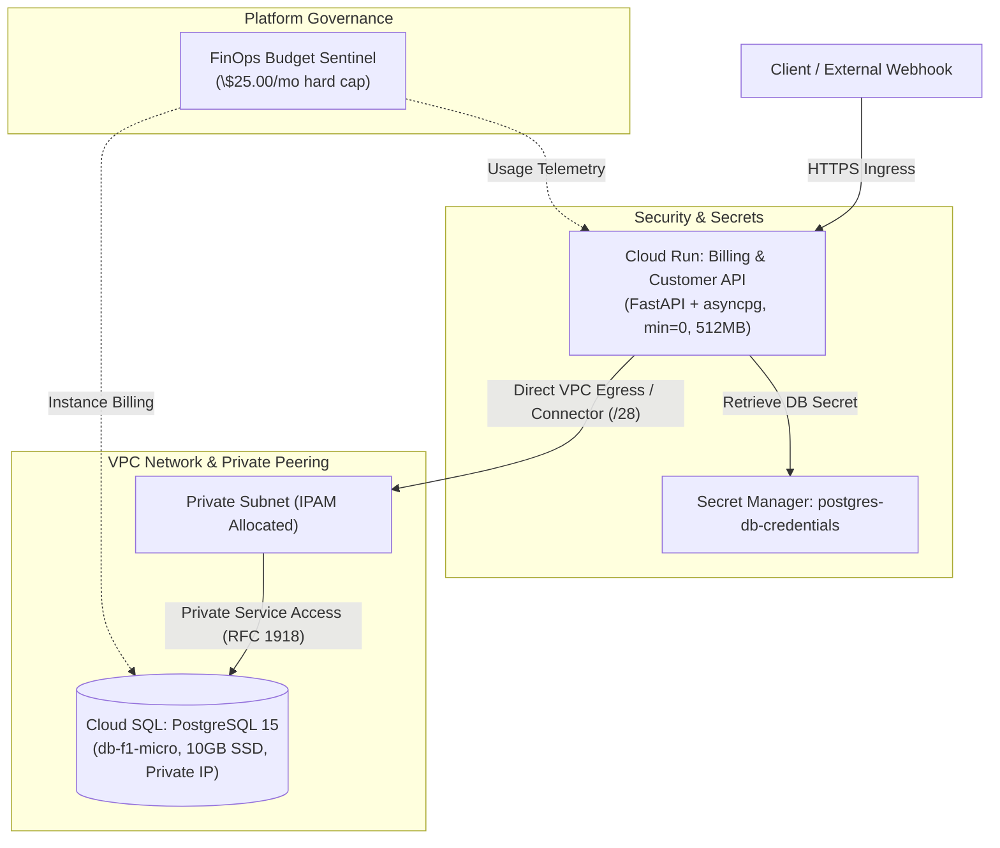

# Test Workload Plan 08: Enterprise CRUD Service with Cloud SQL (PostgreSQL)

## 1. Executive Summary & Objective
* **Product ID**: `test-08-cloudsql-postgres`
* **Complexity Level**: Tier 8 (Relational Data Persistence & Private VPC Networking)
* **Estimated Monthly Spend**: ~\$10.00 – \$18.00 (Governed by strict \$25.00 FinOps ceiling)
* **Lifespan**: 30-Day Sandbox Workload (`is_sandbox: true`, `sandbox_ttl_days: 30`)
* **Primary Objective**: Validate StackVend's capability to autonomously synthesize, verify, and deploy a relational database-backed enterprise CRUD microservice utilizing the **`secure-three-tier-web`** composite infrastructure bundle (or an equivalent composition of golden modules). Tests private IP Cloud SQL provisioning, automated IPAM `/28` CIDR allocation for Serverless VPC networking, Secret Manager database credential injection, SQLAlchemy async connection pooling, and Alembic database schema migrations.

### 📝 Workload Form Submission Prompt (Copy & Paste)
> Please deploy a production-grade enterprise Customer & Billing Management REST API service backed by Cloud SQL PostgreSQL. The API must be built with Python FastAPI and SQLAlchemy (asyncpg) hosted on Google Cloud Run (`min_instances = 0`, 512 MiB) with automated ingress and HTTPS termination.
>
> Provision a dedicated Cloud SQL PostgreSQL 15 instance using the cost-optimized `db-f1-micro` machine tier with private IP access only (`ipv4_enabled = false`) inside the project's private VPC. Allocate a `/28` subnet for Serverless VPC Access (or Direct VPC Egress) using StackVend's IPAM engine. Store database credentials securely in Google Secret Manager (`postgres-db-credentials`) and inject them at runtime.
>
> The service must execute automated schema migrations on startup via Alembic, establishing tables for `organizations`, `billing_accounts`, and `invoices`. Expose standard CRUD REST endpoints (`/api/v1/organizations`, `/api/v1/invoices`) with Pydantic validation, health checks verifying database connectivity (`GET /health/ready`), a 30-Day Sandbox lifecycle with a \$25.00 FinOps budget cap, and comprehensive pytest test coverage using SQLite in-memory mocks.

---

## 2. Infrastructure Architecture & Topology



---

## 3. Cost-Optimized GCP Resources & Pricing Profile

| Resource | Sizing & Configuration | Monthly Cost (Est.) |
| :--- | :--- | :--- |
| **Cloud Run v2 Service** | 1 vCPU, 512 MiB RAM, `min_instances = 0`, `max_instances = 3` (scales to zero) | ~\$0.20 – \$0.50 |
| **Cloud SQL for PostgreSQL** | Tier: **`db-f1-micro`** (1 shared vCPU, 0.6 GB RAM), 10 GB SSD, private IP | ~\$9.60 |
| **VPC Networking** | Direct VPC Egress (or Serverless VPC Access Connector: 2x `f1-micro`) | \$0.00 – \$8.00 |
| **Google Secret Manager** | 1 secret (`postgres-db-credentials`), single active version | \$0.00 (Free Tier) |
| **Cloud Logging & Trace** | Structured application logs & OpenTelemetry SQL query traces | \$0.00 (Free Tier) |
| **Total Estimated Spend** | | **~\$10.00 – \$18.00 / mo** |

* **FinOps Governance**: Budget ceiling configured at `\$25.00 / month` with automated alerting at 50% (\$12.50) and 80% (\$20.00).

---

## 4. Application Specification & Acceptance Criteria

### 4.1 Codebase Structure
```text
test-08-cloudsql-postgres/
├── main.py                     # FastAPI application entrypoint & lifespan lifecycle
├── config.py                   # Pydantic Settings & Secret Manager loader
├── database.py                 # SQLAlchemy async engine & sessionmaker pool
├── models/
│   ├── __init__.py
│   ├── organization.py         # Organization ORM model
│   └── invoice.py              # Invoice & BillingAccount ORM models
├── schemas/
│   ├── __init__.py
│   ├── organization.py         # Pydantic request/response validation schemas
│   └── invoice.py
├── api/
│   ├── __init__.py
│   ├── health.py               # Liveness & DB readiness probes (/health/live, /health/ready)
│   ├── organizations.py        # CRUD endpoints for organizations
│   └── invoices.py             # CRUD endpoints for invoice management
├── migrations/                 # Alembic migration environment & versions
│   ├── env.py
│   └── script.py.mako
├── requirements.txt            # fastapi, uvicorn, sqlalchemy, asyncpg, alembic, google-cloud-secret-manager
└── tests/
    ├── conftest.py             # SQLite async in-memory database test fixtures
    ├── test_health.py          # Health probe tests
    └── test_organizations.py   # REST API integration tests
```

### 4.2 Database & Data Model Specifications
1. **Organizations Table (`organizations`)**:
   * `id`: UUID (Primary Key, default `gen_random_uuid()`).
   * `name`: VARCHAR(255), unique, not null.
   * `plan_tier`: VARCHAR(50), default `'COMMUNITY'`.
   * `created_at`: TIMESTAMPTZ, default `now()`.
2. **Invoices Table (`invoices`)**:
   * `id`: UUID (Primary Key).
   * `organization_id`: Foreign Key referencing `organizations.id` (ON DELETE CASCADE).
   * `amount_cents`: INTEGER, not null (must be positive).
   * `currency`: VARCHAR(3), default `'USD'`.
   * `status`: VARCHAR(20), default `'DRAFT'` (`DRAFT`, `PAID`, `VOID`).
   * `due_date`: DATE, not null.

### 4.3 Startup & Migration Lifecycle
* On container boot, the FastAPI `lifespan` handler runs Alembic `upgrade head` against the PostgreSQL database before accepting incoming HTTP requests.
* Database pool configured with `pool_size = 5`, `max_overflow = 2`, and `pool_pre_ping = True` to avoid stale connections across Cloud Run scale-down events.

---

## 5. Verification & QA Matrix

* **IaC Synthesis**: Validates synthesis of composite bundle `secure-three-tier-web` via OpenTofu v1.9.0 without HCL syntax errors.
* **Deterministic QA Gates**:
  * 100% Pytest pass rate using SQLite in-memory async database driver.
  * Zero Bandit Sev-1/Sev-2 vulnerabilities.
  * Python AST and HCL2 clean parse trees.
* **Dual-Lens Evaluation**:
  * *Lens A (Security)*: Verifies public IPv4 is disabled on Cloud SQL (`ipv4_enabled = false`), credentials are not hardcoded, and IAM service account holds only `roles/cloudsql.client`.
  * *Lens B (Spec Adherence)*: Confirms Alembic migration definitions match ORM models (no missed directive).
