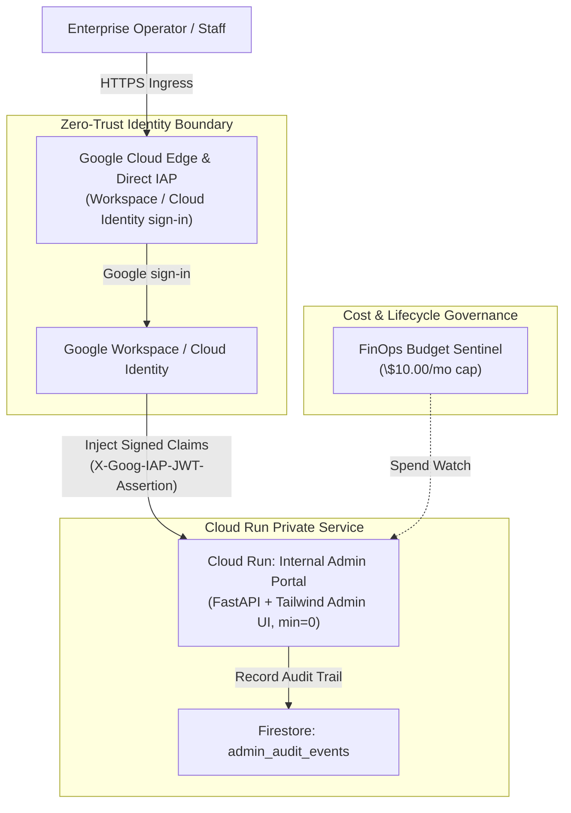

# Test Workload Plan 09: Internal Enterprise Admin Portal with Direct IAP

## 1. Executive Summary & Objective
* **Product ID**: `test-09-internal-admin-direct-iap`
* **Complexity Level**: Tier 9 (Zero-Trust Identity-Aware Proxy & Corporate SSO)
* **Estimated Monthly Spend**: ~\$0.50 – \$2.00 (100% Serverless, \$0 Base Load Balancer Cost)
* **Lifespan**: 30-Day Sandbox Workload (`is_sandbox: true`, `sandbox_ttl_days: 30`)
* **Primary Objective**: Validate StackVend's **Direct IAP Integration Engine (`STEP-03D-DIRECT-IAP`)**. Exercises the automated deployment of an internal back-office administration portal hosted on Google Cloud Run protected natively by Identity-Aware Proxy (IAP) with Google Workspace or Cloud Identity sign-in, with no OAuth client to create or manage—**bypassing the need for an expensive \$18/month Google Cloud Load Balancer (GLB)**.

### 📝 Workload Form Submission Prompt (Copy & Paste)
> Please deploy a secure internal enterprise administration portal for system operators and support staff. The portal must be hosted on Google Cloud Run (`min_instances = 0`, 512 MiB) built with FastAPI and an embedded Tailwind CSS administrative UI.
>
> Secure the service using Cloud Run Direct IAP (`STEP-03D-DIRECT-IAP`), with no OAuth client or client secret. Ingress must be restricted so unauthenticated public requests are intercepted at the perimeter by Google IAM/IAP.
>
> The backend application must include an authentication middleware that verifies the signed JWT assertion header (`X-Goog-IAP-JWT-Assertion`) with IAP's public keys against this Cloud Run service's audience (`/projects/<project-number>/locations/<region>/services/<service-name>`; the OAuth client is not the audience) and takes the operator's identity from the verified claims, never from the unsigned `X-Goog-Authenticated-User-Email` header. Implement role-based access control (RBAC) distinguishing between `Viewer` and `SuperAdmin` operators. All administrative actions (user role updates, feature flag toggles) must emit immutable audit log entries into Google Cloud Firestore (`admin_audit_events`). Provide 100% passing pytest coverage, with tests that sign IAP assertions using a locally generated ES256 key so the real verification runs, and a \$10.00 FinOps budget cap.

---

## 2. Infrastructure Architecture & Topology



---

## 3. Cost-Optimized GCP Resources: Zero Load Balancer Overhead

> [!IMPORTANT]
> **No \$18/Month Global Load Balancer Required**:
> Traditional GCP IAP architectures require provisioning an external HTTP(S) Load Balancer (`compute.googleapis.com`), incurring minimum baseline forwarding rule charges of ~\$18.00–\$25.00/month even when completely idle.
> 
> StackVend's **Direct IAP Engine (`STEP-03D-DIRECT-IAP`)** turns on IAP directly on the Cloud Run service with a Google-managed client, delivering enterprise-grade zero-trust identity authentication at **\$0.00/month idle cost**.

### Sizing & Monthly Spend:
1. **Cloud Run Service (Internal Admin Portal)**:
   * CPU: `1 vCPU`, Memory: `512 MiB`, `min_instances = 0`, `max_instances = 2`.
   * Scales to zero when operators are inactive: **~\$0.30 – \$1.00 / month**.
2. **Direct IAP**:
   * IAP is enabled on the Cloud Run service; no OAuth client ID or secret.
   * **\$0.00**.
3. **Google Cloud Firestore (Native Mode)**:
   * Collections: `admin_audit_events`, `system_flags`.
   * Free tier covers up to 50k reads / 20k writes per day: **\$0.00**.
4. **Total Monthly Spend**: **~\$0.50 – \$2.00 / month** (FinOps hard stop: `\$10.00`).

---

## 4. Application Specification & Acceptance Criteria

### 4.1 Application Structure
```text
test-09-internal-admin-direct-iap/
├── main.py                     # FastAPI app, middleware, and route mounting
├── middleware/
│   ├── __init__.py
│   └── iap_auth.py             # Middleware validating X-Goog-IAP-JWT-Assertion & extracting email
├── core/
│   ├── config.py               # Application settings and IAP audience verification
│   └── rbac.py                 # Role-Based Access Control logic (Viewer vs SuperAdmin)
├── services/
│   ├── __init__.py
│   └── audit_service.py        # Firestore audit logger for administrative changes
├── templates/
│   ├── base.html               # Base layout with Tailwind CSS & responsive navigation
│   ├── dashboard.html          # Operational dashboard displaying system metrics
│   └── audit_logs.html         # Live-updating table of administrative events
├── requirements.txt            # fastapi, uvicorn, jinja2, google-cloud-firestore, google-auth, requests, cryptography
└── tests/
    ├── conftest.py             # Test client fixtures signing IAP assertions with a test ES256 key
    ├── test_iap_auth.py        # Unit tests validating IAP JWT claims & rejection of unsigned calls
    └── test_admin_api.py       # Integration tests for admin actions and audit logging
```

### 4.2 Security & Authentication Workflow:
1. **Header Validation**:
   * The middleware verifies `X-Goog-IAP-JWT-Assertion`, the ES256-signed JSON Web Token from Google, with IAP's public keys and this service's audience (`/projects/<project-number>/locations/<region>/services/<service-name>`). The operator's identity is the `email` claim of the verified token.
   * `X-Goog-Authenticated-User-Email` (e.g. `accounts.google.com:operator@company.com`) is unsigned and is never used as proof of identity.
   * Non-test code has no bypass or mock mode: a missing or failed assertion returns HTTP 401.
2. **RBAC Rules**:
   * `Viewer`: Can view dashboard metrics and audit logs (`GET /admin/*`).
   * `SuperAdmin`: Can toggle feature flags and trigger administrative actions (`POST /admin/actions/*`).
   * SuperAdmins are the workload's app administrators: StackVend sets them on the service as `STACKVEND_APP_ADMIN_EMAILS` (by default the Control Center account that created the workload, when it is also a `user:` member; see [Known limitations](../known-limitations.md#app-administrators-of-a-private-iap-app-cannot-be-changed-yet)). No first-user or self-service bootstrap.
3. **Audit Trail**:
   * Any state modification writes an event document to `admin_audit_events` containing: `timestamp`, `operator_email`, `action_type`, `target_resource`, and `client_ip`.

---

## 5. Verification & QA Matrix

* **OpenTofu Synthesis**: Validates synthesis of Cloud Run v2 with IAP integration and IAM policy bindings (`roles/iap.httpsResourceAccessor`).
* **Deterministic QA Hard Gates**:
  * 100% Pytest pass rate across authentication middleware, RBAC enforcement, and audit logger.
  * Zero Bandit Sev-1/Sev-2 vulnerabilities.
  * AST syntax and HCL2 clean parse trees.
* **Dual-Lens Audit**:
  * *Lens A (Security)*: Verifies that unauthenticated requests without valid IAP assertions return HTTP 401/403.
  * *Lens B (Spec Adherence)*: Confirms full implementation of audit trail collection and RBAC matrix (no missed directive), including that a listed app administrator holds SuperAdmin at runtime.
* **Live business-path check**: signed in as the creating operator, `PUT` a feature flag and a user role, then confirm `admin_audit_events` has entries; a second member who is not an app administrator gets HTTP 403.
