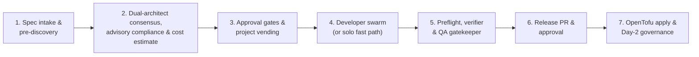

# StackVend Overview

**StackVend** (originally codenamed Project Castor) is a multi-agent system that turns a product specification into a tested, deployed workload running in its own isolated Google Cloud project.

> **Public preview.** StackVend is a proof of concept under active development. It is not production-ready, security hardening is in progress, and every piece of generated infrastructure should be reviewed by a human before it is applied to an environment you care about.

---

## What problem does StackVend address?

AI coding assistants usually stop at generating code snippets. The surrounding work is still manual:

- writing and debugging Infrastructure-as-Code (Terraform / OpenTofu);
- configuring IAM roles, service accounts and networking;
- setting up CI/CD and container builds;
- keeping an eye on runtime errors and cloud spend.

StackVend tries to close that loop. You provide a specification (typed into the Control Center, uploaded as a document, or dropped into a Google Drive intake folder). The platform designs an architecture, checks it against organization policies and quotas, generates application code and IaC, runs deterministic quality gates, creates a dedicated Google Cloud project for the workload, deploys it, and then keeps governing it (cost, errors, expiry).

LLM output is treated as untrusted. Between every generation step and every cloud mutation there are deterministic checks (parsers, validators, tests, approval gates). Some of those checks are still being redesigned; see the roadmap in the [documentation index](README.md#roadmap).

---

## The spec-to-cloud pipeline

The pipeline is a Google Cloud Workflows state machine (`workflows/main_orchestrator.yaml`) that calls the orchestrator gateway and other services over HTTP and resumes on callbacks for long-running steps. Per-workload state lives in Firestore (`workloads/{product_id}`).

### 1. Spec intake and pre-discovery

A specification arrives from the Control Center (typed text, an uploaded PDF/DOCX/Markdown/text/JSON/YAML file, or an express "registered modules" form) or from a Google Drive intake folder polled by the `spec-ingestion` service.

Before any AI reasoning, the platform gathers facts:

- **Organization policies.** The compliance MCP server reads the effective organization policies that apply to the target folder or project (for example domain-restricted sharing, ingress restrictions, external-IP rules, default-network creation, uniform bucket-level access and OS Login) so they can be passed to the agents as constraints.
- **Regional quotas.** A quota inspector checks headroom in candidate regions (`us-central1`, `us-east4` and `europe-west1` by default).

### 2. Dual-architect consensus, advisory compliance review and cost estimate

An architect agent decomposes the spec into a sequenced build plan (a 7-step task DAG) and writes an architecture document into the workload's `docs/planning/` directory. A red-team critic then reviews the plan against policy constraints, dependency cycles and quota availability. If the critic finds no critical issue, consensus is recorded (`CONSENSUS_VERIFIED`). If it does, the consensus engine runs one bounded remediation turn and the critic reviews the patched plan again: the plan is recorded as `AUTO_REMEDIATED` only when that second review finds no critical issue, otherwise as `CRITIQUE_FAILED`. A very large spec (split into sections and planned section by section) gets no remediation turn; its critical findings are recorded as `CRITIQUE_FAILED`. Which Gemini models fill each role is configurable (see [Configuration](configuration.md#2-ai-model-settings)).

An advisory compliance review then looks at the plan against ingress and policy constraints (it adds required tasks to the plan and does not verify the generated HCL; it stops a run only for typed reasons, such as an invalid compliance profile or a decision that requires internal-only ingress on a plan with Cloud Run services, which this release cannot deliver), and a FinOps step produces a rough monthly cost estimate (via the Infracost MCP server).

### 3. Approval gates and project vending

When plan approval is required for the workload, the workflow pauses for an operator to approve the architecture plan (the **HITL Approvals** tab in the Control Center). A deterministic quota-feasibility check runs next.

The vending service then creates a dedicated Google Cloud project for the workload under the configured folder, links billing (when permitted), enables the required APIs, creates service accounts, reserves network address space with the IPAM component, sets up Workload Identity Federation for the workload's GitHub Actions, and creates the workload repository.

### 4. Developer swarm or solo fast path

A lead developer classifies the work:

- **`SOLO_FAST_PATH`** for small changes to an existing repository (a single-step plan, existing files present, and a short spec). The lead developer generates the change directly.
- **`STANDARD_SWARM` / `ENTERPRISE_SWARM`** for larger work. The lead developer produces a work breakdown with disjoint file assignments and frozen shared contracts, and specialist juniors (backend, frontend, IaC, test, DevOps and database personas) run in sequential waves, with the juniors inside each wave running concurrently.

Application code is built with Cloud Native Buildpacks; generated workloads do not contain Dockerfiles.

### 5. Preflight, synthesis verifier and QA gatekeeper

Generated files go through preflight validation (syntax checks for Python and HCL, IaC reference-graph checks, a ban on Dockerfiles, and compiler-level validation) and a pre-commit synthesis verifier that checks things such as imports, dependencies and container contracts. After commit, a QA stage runs the generated tests and security scans in an ephemeral sandbox (`apps/qa-runner`), and a dual-lens review (security, and adherence to the spec's acceptance criteria) scores the change. When the workload's own tests or the review find a code defect, the developer agent gets up to three more rounds (a targeted repair from QA's findings when they name the workload's files, otherwise a regeneration); a round whose QA findings are identical to the previous round's stops the run, and a run that still fails after the third round stops at QA. See [Platform Internals](platform-internals.md) for details.

### 6. Release promotion and human approval

A pull request is opened on GitHub or on the serverless Git provider. Depending on workload policy, the pipeline either merges automatically or pauses for an operator decision in the Control Center.

### 7. Deployment and Day-2 governance

Infrastructure is applied by the `tf-applier` Cloud Run job using OpenTofu (default) or Terraform with a remote Cloud Storage state backend. The application itself is built with buildpacks and deployed to Cloud Run through the workload's GitHub Actions workflow. After deployment:

- **FinOps.** Spend is synchronized on a schedule and projected against the workload's monthly budget. A configurable breach policy (alert only, scale to zero, require confirmation, or unlink billing) acts on Cloud Billing budget notifications; StackVend does not create those budgets yet (see [Known Limitations](known-limitations.md)).
- **SRE sentinel.** Cloud Logging errors arrive via Pub/Sub, are fingerprinted and de-duplicated, and can trigger a remediation workflow (`workflows/sre_remediation.yaml`) when auto-healing is enabled for the workload. Automatic repair of workloads is off in this preview (see [Known Limitations](known-limitations.md)).
- **Sandbox lifecycle.** Workloads flagged as sandboxes expire automatically unless an operator extends or promotes them. See [Workload Lifecycle](workload-lifecycle.md).

---

## Where to go next

- [Quickstart](quickstart.md): bootstrap the platform in a Google Cloud project.
- [Architecture](architecture.md): services, MCP servers and isolation model.
- [Composite Bundles](composite-bundles.md): the built-in infrastructure catalog.
- [Configuration](configuration.md): platform settings and policies.
- [Contributing](../CONTRIBUTING.md): local setup and project rules.
