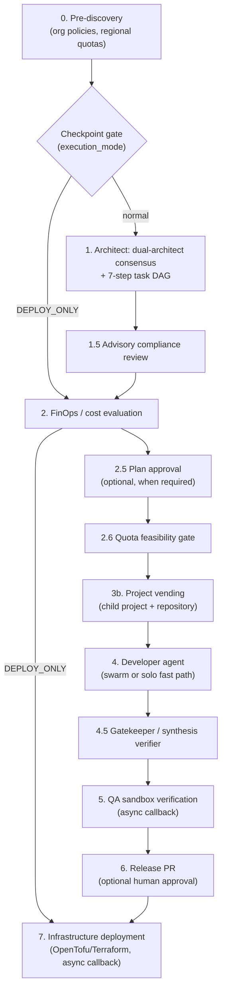
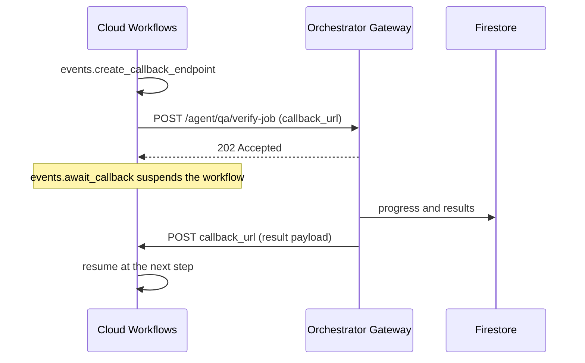

# StackVend Platform Internals & Execution Mechanics

This document describes how the pipeline is wired internally. It is the main technical reference for engineers and AI coding assistants who work on the platform.

> **Public preview, moving target.** The IaC validation and repair logic in particular is under active redesign: the project is replacing text-rewriting "sanitizers" with real validators and bounded repair loops (see [`CONTRIBUTING.md`](../CONTRIBUTING.md)). Function names below are accurate at the time of writing but some are expected to be removed or replaced. Where this document and the code disagree, the code wins.

---

## 1. End-to-end execution lifecycle

The state machine in `workflows/main_orchestrator.yaml` runs these steps (step numbers are those used in comments in the file):

Modes: `DEPLOY_ONLY` (infrastructure code already merged; after the cost step the workflow skips everything up to deployment, including approvals, vending, the developer, gatekeeper, QA and release steps) and `RESUME_DEVELOPER` (resume at the developer step after a failure) are selected by the checkpoint gate. A resume reuses the last full build's passed pre-build gate, its compliance decision and its Task DAG (kept in `workloads/{id}/prebuild_task_dags/{trace}` for QA's adherence judge, and given to the developer as well when the specification is 1,500 characters or more, the length at which the full swarm runs anyway; a shorter specification keeps an empty plan and the single-pass repair); without any of these it stops and asks for a full build.

---

## 2. Orchestrator gateway (`apps/orchestrator-gateway`)

`main.py` is a FastAPI application that exposes the agent endpoints the workflow calls, for example:

| Endpoint | Purpose |
| :--- | :--- |
| `POST /agent/architect/decompose-job` (and the synchronous `/decompose`) | Architect + red-team critic consensus; the task DAG arrives on the workflow's callback. |
| `POST /agent/compliance/audit` | Advisory compliance review (adds required tasks to the plan). Stops the run with `COMPLIANCE.PRIVATE_INGRESS_UNSUPPORTED` (409) when the decision requires internal-only ingress and the plan has a Cloud Run service. |
| `POST /agent/developer/execute-job` (and the synchronous `/execute`) | Developer agent: generate code, run preflight, commit to a branch; the result arrives on the workflow's callback. |
| `POST /agent/gatekeeper/verify` | Synthesis verifier (pre-commit hard gate). |
| `POST /agent/qa/verify-job` (and the synchronous `/verify`) | QA sandbox verification and the Stage 2 review; the verdict arrives on the workflow's callback. |
| `POST /agent/release/promote` | Release: pull request. |
| `POST /discovery/quotas`, `/discovery/validate-headroom` | Quota harvesting and feasibility. |
| `POST /events/workflow-status` | Workflow progress updates written to Firestore for the UI. |

Every agent stage runs under one stage deadline (`stage_deadline.py`, table `STAGE_BUDGETS`): the budget sits below the
workflow's own bound for that call, no new model call, wave or repair round starts after it, and a model call never
outlives it. A stage that runs out answers `STAGE_DEADLINE_EXCEEDED` (HTTP 504) with the stage and its progress, and
nothing is committed or merged after a stage has answered. The architect, developer and QA stages run as jobs
(`stage_jobs.py`, `stage_runner.py`): the route validates the request, stores it in Firestore
(`pipeline_executions/{trace}/stage_job_requests/{job_id}`, one per workflow callback, which also makes the job
single-run), starts one execution of the `stage-runner` Cloud Run Job (the gateway's own image) and answers 202 once
the execution exists. The job runs the stage and posts the result to the workflow's callback, so these stages are not
limited by the 30-minute cap on one workflow HTTP call (budgets 30, 60 and 45 minutes, counted from when the gateway
accepted the stage). Between waits of at most five minutes the workflow asks `GET /agent/stage-job/state`; an execution
that ended without an answer ends the run `STAGE_INTERRUPTED`. The gateway's `/health` reports `stage_jobs_enabled`;
when it is false the workflow calls the synchronous routes as before (the rollback switch).

### `developer_agent/`

* **`handler.py`**: entrypoint. Loads the spec and plan, decides between solo and swarm execution, runs preflight, and commits to Git.
* **`lead_orchestrator.py`**: the lead developer. Classifies the work (`SwarmExecutionMode`: `SOLO_FAST_PATH`, `STANDARD_SWARM`, `ENTERPRISE_SWARM`) and produces a work-breakdown plan with disjoint file assignments and immutable "wave 0" contract files. In each service the wave 0 contracts are the package `schemas/`: `schemas/contracts.py`, and a `schemas/__init__.py` that re-exports it together with every `schemas/<name>.py` module the plan assigns. A plan that assigns one of the platform's contract files, or a `schemas.py` module beside that package (Python would never import it), is asked again on the next model with the exact paths. `SOLO_FAST_PATH` is chosen when the plan has at most one step, the repository already has files, and the spec is under 1,500 characters.
* **`swarm_dispatcher.py`**: runs the plan wave by wave. Tasks inside a wave run concurrently under a semaphore; later waves receive the files they depend on from earlier waves. It applies rate-limit handling and a token budget (the "swarm token envelope").
* **`juniors/`**: the specialist workers: `backend_worker.py`, `frontend_worker.py`, `iac_worker.py`, `test_worker.py`, `devops_worker.py`, plus `prompt_registry.py`. A database persona (`DATABASE_ENGINEER`) exists in `swarm_schemas.py` and reuses the backend worker prompt (`prompt_registry.py`); there is no separate `db_worker` module.
* **`swarm_schemas.py`**: `JuniorPersona`, `SwarmExecutionMode`, task and plan schemas. Waves are numbered 1 to 3 (foundation/contracts, services and UI, quality and delivery).
* **`prompt.py`**: system prompts for the lead developer and platform rules injected into generation.
* **`terraform_engine.py`**: synthesizes workload IaC from the plan: archetype detection, `generate_golden_main_tf`, `generate_golden_variables_tf`, `generate_golden_outputs_tf`, bundle and module vendoring (`vendor_composite_bundle`, `vendor_terraform_modules`; the modules to vendor come from the parsed `source` of each module call, so a commented-out line vendors nothing), environment-variable wiring (`extract_custom_resource_env_vars`). It writes no application code: a service the plan names but the AI did not write is reported as `CONTAINER.ENTRYPOINT_MISSING` (validator V3c-planned) instead of getting a placeholder app.
* **`preflight_validator.py`**: deterministic checks that run after generation and before the commit (section 3).

### Other agent packages

* **`architect_agent/`**: `handler.py`, `context.py` (the run context: organization policies, REWORK feedback, quota, current topology, given to every path), `spec_decomposer.py` (chunked map-reduce for very large specs, at most 24 sections), `consensus_engine.py` (bounded remediation turn, then a re-review), `red_team_critic.py`, `cycle_detector.py`, `topology_gate.py`, `plan_contract.py` (see below).
* **`gatekeeper_agent/verifier.py`**: `SynthesisVerifierAgent.verify_and_cure`, the pre-commit hard gate (section 3).
* **`qa_auditor/`**: the dual-lens review (`security_lens.py`, `adherence_lens.py`) combined by `coordinator.py`.
* **`compliance_agent/`** and **`release_gatekeeper.py`**.

**Architect plan contract (`architect_agent/plan_contract.py`).** After consensus and before the topology gate, the architect stage checks the final plan against what the platform can honour, so a plan that asks for a file the platform deletes is fixed before any project is vended or any code is written. `check_plan_contract` reads only the typed `target_files` of every task and build step (never descriptions or acceptance criteria) and reports, as `Diagnostic` entries, `PLAN.PLATFORM_CI_FILE` for a CI file the developer stage removes and the platform never writes (any `.github/workflows/` file except the platform's `deploy-<service>.yml`, and the root `cloudbuild.yaml` on a GitHub workload) and `PLAN.CONTAINER_FILE` for a `Dockerfile`, `Dockerfile.*` or `.dockerignore` (images are built with Buildpacks). The rules are the same exact predicates the developer stage and the QA judge use (`is_platform_ci_path`, `is_platform_deploy_workflow`, `is_prohibited_container_file`), so the three cannot drift apart. When the workload's VCS provider cannot be read, only the root-`cloudbuild.yaml` rule is skipped, and the stage trace records it under `not_checked`. A plan with no violation continues unchanged, with no extra model call. Otherwise `gate_plan_contract` sends the exact list back to the architect through the same remediation turn the consensus engine uses (at most `MAX_PLAN_CONTRACT_REPLANS` = 2 turns, the second only when every file it was told about is gone; no turn for a map-reduce plan, without a model, or with less than `PLAN_CONTRACT_REPLAN_MIN_S` seconds of stage budget left). A re-plan is accepted only when it is a real plan with no violation, no task-graph error it introduced (`PLAN.DAG_INVALID`) and the draft's typed compute decision unchanged (`compute_archetype`, `target_compute_services` in order, and the parsed topology's services, kinds and primary service: `compute_scope_changes`, because the critic audited the draft, not the re-plan; a change is the failed turn `REPLAN_CHANGED_COMPUTE`); errors already in the draft are recorded, not refused. A re-plan whose every model answer has a compute archetype outside the enum is a failed turn (`REPLAN_UNUSABLE`), not an outage. When the re-plan does not succeed, `PLAN_CONTRACT_ON_EXHAUSTION` decides: `"STRIP"` (the default) removes the flagged entries from the audited draft and adds a "Platform plan contract" note to the plan document; a flagged CI file is kept (and recorded under `kept`) only in a plan task whose QA judge facts rest on it (removing it would change `judge_input.task_fact_kinds` for the task, e.g. `cloudbuild.yaml` in a RELEASE task), so the judge still reads "CI/CD facts apply" for a task whose text asks for the file; build steps are always stripped; `"FAIL"` stops the run at the architect stage with `PlanContractViolationError` (`ARCHITECT_PLAN_CONTRACT_VIOLATION`, error class `ARCHITECT_DEFECT`), before compliance, approval and vending. A model outage during a re-plan (no model answer, every model rate-limited, or another `GATE_UNAVAILABLE` error of the re-plan call) is, under `"STRIP"`, a failed turn (`MODEL_UNAVAILABLE`, its error class and reason recorded; stopped `REPLAN_MODEL_UNAVAILABLE`) and the audited draft is stripped, so the check never fails a run that passed before it; under `"FAIL"` it fails the stage as `GATE_UNAVAILABLE` (`ARCHITECT_NO_MODEL_RESPONSE`, `ARCHITECT_RATE_LIMITED`). An outage of the architect's first (outer) call and a stage stop are never caught by the check. An unexpected exception inside the check is `PlatformDefectError` `PLAN_CONTRACT_GATE_DEFECT` at stage `architect`. The outcome (`PASSED`, `REPLANNED`, `STRIPPED`, `REFUSED`, or `INTERRUPTED` when an outage under `"FAIL"`, a typed error, a gate defect or a stage stop left the gate) is written to the architect stage trace field `plan_contract` whenever the gate ran; a stage stop writes no trace, and the deterministic fallback plan never reaches the gate (the field is absent; the topology gate refuses that plan). After a strip, the trace's `agent_output` is still the architect's unstripped answer: `plan_contract.stripped` holds what was removed or kept. When a re-plan is refused or the stage fails after one, the build plan and implementation plan documents of that trace may hold the refused re-plan (the inner call persists them; the outer write replaces them only when the stage continues). IAM roles are not checked here (the plan has no typed role field); the architect prompt's refused-roles line and the QA judge's facets cover them.

### Execution modes

* **Swarm** (`STANDARD_SWARM`, `ENTERPRISE_SWARM`): wave-based, as above.
* **Solo fast path** (`SOLO_FAST_PATH`): the lead developer generates the change directly with no junior workers.
* **Deploy only** (`DEPLOY_ONLY`): selected by the workflow when valid infrastructure code is already merged. Everything between the cost evaluation and the infrastructure deployment is skipped.

---

## 3. Preflight and gatekeeper

Two deterministic stages sit between LLM output and the repository.

### Preflight checks (`developer_agent/preflight_validator.py`, `developer_agent/handler.py`)

Run inside the developer agent before the commit. Representative checks:

* **HCL**: nothing here rewrites or judges HCL any more. Syntax, references, duplicates and literal names that GCP rejects are reported by `tofu validate` (validator V1b) and the other hallucination-stack validators in `developer_agent/validators/`; a resource name built from variables is resolved with the platform's own values (`var.product_id`, `var.region`, `var.project_id`, the platform-rendered `terraform.tfvars`) and checked against the GCP rule for that resource type (V2k, `IAC.NAME_INVALID`). The AI fixes every finding in the bounded repair loop.
* **Container contract** (`enforce_container_contract`, one rule): removes `Dockerfile`, `Dockerfile.<x>` and `.dockerignore` files (exact names, `is_prohibited_container_file`), since workloads use buildpacks; pins `.python-version` to 3.13 in every deployed service and at the root; and adds an empty `<dir>/.gitkeep` only for a directory that a service's Python code mounts with a literal `StaticFiles(directory="<dir>")` (found with Python's `ast`, so a comment or a string never counts) and that holds no file yet.
* **Python requirements and packages** (add-only, in the synthesis verifier below): `reconcile_service_requirements` appends to a service's `requirements.txt` only a distribution that an AST-read import (or the Procfile's server) proves missing; `purge_shadowed_package_files` adds missing `__init__.py` files. Neither changes, moves or deletes an existing file; a file that does not compile is reported (validator V3a, `PY.SYNTAX`). Module-layout hazards (a module named like the standard library, a module beside a same-named package, an import that cannot resolve from the service root) are reported by the report-only `PythonLayoutValidator`.
* **Kubernetes manifests**: `hydrate_kubernetes_manifests` substitutes only the explicit placeholders in `K8S_MANIFEST_PLACEHOLDERS` (`${PROJECT_ID}` = the vended child project, `${PRODUCT_ID}`, `${REGION}` = the platform region setting, `${SERVICE_NAME}`, `${ARTIFACT_REGISTRY}` = `<region>-docker.pkg.dev/<project>/<product>`) in `k8s/` manifests. Concrete images and Workload Identity annotations are never rewritten. An unavailable value, or a container image / WI annotation that still contains `$`, raises `ManifestHydrationError`.

Design rule: a healer must not touch input that is already valid ("Do No Harm") and each needs a negative test. The generation-time HCL rewriters (naming, invented variable defaults and locals, timeouts, duplicate-cluster removal, guessed Workload Identity roles, a fixed-region image) are deleted; their cases are reported by validators and repaired by the AI through the bounded repair loop (`developer_agent/repair_loop.py`). At deploy, the terraform MCP's `prepare_workspace` writes the committed files to the deploy workspace as they are: it no longer rewrites names, provider versions, variable defaults, outputs, references or workflow files, and adds no variables, locals or data sources (Dockerfiles are still dropped, invariant 4). Besides the state backend configuration, it adds only the container contract's empty `<dir>/.gitkeep` for a directory that Python code really mounts with a literal `StaticFiles(directory="<dir>")` and that holds no file yet (the same `ast` rule, `shared/static_mounts.py`), in the deploy workspace only. A file that would not apply fails `tofu validate` or apply and the error is reported back. It also no longer repairs syntax or `locals` and no longer refreshes vendored golden modules, and a deploy never commits to the workload repository (the former "GitOps write-back" of healed files is gone). A vendored golden module that differs from the platform's module payload is applied as committed and reported (`PLATFORM.VENDORED_MODULE_STALE`, `stale_vendored_module_files`); the deploy marks the workload's IaC summary (`iac_drift_detected` / `iac_drift_count`, the Control Center **IaC Update** badge) and the fix is the **Upgrade IaC** pull request, which Code Freeze blocks. After a validate or apply error the deploy rewrites no file and guesses no variable value: the engine's error goes back to the developer agent's bounded regeneration (`tf_retry_count`). The remaining error reactions are cloud-side and write no file (importing a resource that already exists, at the exact address of the plan that was applied and with the import id built from that plan's attributes, never a guessed name; a conflict the plan cannot name exactly fails with `APPLY_ADOPTION_UNRESOLVED`; retrying a Cloud Run creation timeout, one `initializeAuth` call plus one retry when Identity Platform is not initialized, and, for the Cloud SQL instances the plan creates that are missing from state after a failed apply, reading this deploy's own create operations from the SQL Admin API (`operationType`, `targetProject`, `targetId`, `insertTime`, `status`, `error.errors[].code`, the instance `state`, the users' `name` / `host`; `cloudsql_create_recovery.py`), waiting up to 25 minutes for them, then importing every instance and applying once more only when each finished without an error, is `RUNNABLE`, has no `root`@`%` user and was not planned as a backup restore, else importing none and failing with `CLOUDSQL_CREATE_UNRESOLVED` for an operator; a 409 on a planned Cloud SQL instance is adopted only under the same instance checks). A subnetwork range conflict fails with `SUBNET_CIDR_CONFLICT`; nothing outside the plan is deleted. An apply that fails on a Cloud Run startup probe is reported FAILED; it is no longer turned into a success when some revision of the service is Ready. A committed workflow file that fails the platform's workflow check stops the deploy and the plan with `APPLY.WORKFLOW_INVALID` (file and line) for an operator. The deploy-time additions for GKE / Compute Engine workloads (Kubernetes provider and outputs, subnetwork lifecycle, rollout timeouts, Workload Identity bindings, an extra Cloud Run gateway module) were removed: such a workload is applied as committed. A Cloud Run service whose plan sets `PORT` stops before anything is applied with `APPLY.RESERVED_ENV_PORT`, and Terraform under the old `infra/workloads/` folder is used only when it is the workload's only Terraform, otherwise the deploy stops with `APPLY.PLURAL_WORKLOADS_NOT_APPLIED`. Before the container build, the deploy also aligns `requirements.txt` pins to the platform package list (`sanitize_wheel_requirements`) in the build workspace only; this runs after QA (see [Known Limitations](known-limitations.md)).

### Synthesis verifier (`gatekeeper_agent/verifier.py`)

`SynthesisVerifierAgent.verify_and_cure` runs as workflow step 4.5. It compiles Python in memory, adds missing package `__init__.py` files and proven-missing requirement lines (add-only), binds IaC environment variables, vendors referenced modules, and verifies entrypoint imports. The environment-variable binding (`reconcile_iac_environment_contracts`) writes only keys a module does not bind yet, with an exact parser edit: python-hcl2 locates the module's `env_vars` (`var.env_vars` or `merge(var.env_vars, {...})`), the new keys are appended, and the edit is kept only when a re-parse confirms that nothing else in the file changed. A workload that already binds every key is returned byte-identical. It no longer re-points service accounts or Pub/Sub push endpoints by name; a wrong reference is reported and the AI repairs it.

---

## 4. Cloud Workflows callbacks

Long-running steps (the architect, developer and QA stages, project vending, human approvals, infrastructure deployment) use the Cloud Workflows HTTP callback pattern. For the three agent stages the workflow's `run_stage_job` subworkflow does this and the `stage-runner` job answers; a stage that does not call back in time ends the run as `STAGE_TIMEOUT`, and a stage job that ended without an answer as `STAGE_INTERRUPTED`:

Progress for the UI is written by `POST /events/workflow-status` to the Firestore `workloads/{product_id}` document, which the Control Center reads for the Flight Deck.

---

## 5. Project vending (`apps/project-vending`)

The vending service isolates each workload in a dedicated Google Cloud project:

1. Creates a project through Cloud Resource Manager v3 under the configured folder. The project ID is derived from the product ID (lowercase, at most 30 characters, with a random suffix when needed).
2. Attaches the billing account if the platform's service account is permitted to.
3. Enables APIs, creates service accounts and IAM bindings for the workload and grants platform administrators read access.
4. Records and passes the inputs for Workload Identity Federation (`castor-gh-pool`, deployer account `sa-gh-deployer`), so the workload's GitHub Actions can deploy without a stored service-account key; the pool, its provider and the deployer account themselves are created by the workload's first deploy (the `workload-foundation` module). The provider's attribute condition limits access to one branch of the workload's own repository: its recorded default branch (`workloads/{product_id}.default_branch`, `main` when none is recorded), passed by the platform as the foundation module's `github_default_branch` and validated there with the platform's branch-name rules. Vending also records the repository's immutable numeric GitHub id (`workloads/{product_id}.github_repository_identity`, read with the platform's GitHub client); when the record names the repository being applied, tf-applier passes the id to the foundation module and the condition also requires `assertion.repository_id`. A recorded id is never replaced silently: if the repository is deleted and re-created under the same name, CI deploys are refused until an operator clears that field and the workload is vended again; for a repository named after the workload id, vending instead stops with `GITHUB_REPOSITORY_ID_CHANGED` and keeps the record: remove or rename the new repository on GitHub, then restore the original from the organization's Deleted repositories (it keeps its id) and run the workload again. Only on a Shared runner install can the workload move to the new repository instead (rename it and re-submit the workload with that name in **Target GitHub Repository**); on a Per-workload install the runner identity pins the original repository and refuses another one (`VENDING.RUNNER_REPOSITORY_MISMATCH`). The deploy secrets (`GCP_PROJECT_ID`, `WIF_PROVIDER`, `WIF_SERVICE_ACCOUNT`) are repository secrets, so workloads that share one repository (a workload promoted with *Deploy to New Folder* gets a branch in the source workload's repository) cannot all use the plain names: a redeploy writes such a workload's secrets with its branch as a suffix (upper case, every character other than a letter, digit or `_` becomes `_`, for example `WIF_PROVIDER_RELEASE_V1_2` for `release/v1.2`), and its generated deploy workflows read those branch-named secrets first, then the plain ones. A workload on its own repository, and every workflow on `main`, read the plain names only. StackVend builds and applies its own merges itself: the merge commit of the release auto-merge and of a Control Center approval carries GitHub's `[skip actions]` directive (`PLATFORM_MERGE_SKIP_ACTIONS` in `shared/vcs_ledger.py`), so the generated deploy workflows run only for later pushes by people (see [Known Limitations](known-limitations.md#github-actions-deploy-of-a-workload-preview)).
5. Allocates network ranges through the IPAM component (`shared/ipam.py`) and creates the workload repository (named after the workload id by default: lower case, `_` becomes `-`, from `default_repository_name` in `shared/github_identity.py`; a record that already names a repository keeps it). Before creating it, vending records the name in the workload's `github_repository_identity` (a claim without an id, written only after GitHub answers that no such repository exists), so a retried or interrupted create reuses the repository it made. An existing GitHub repository under that name is used only when that record names it (a re-run of the same workload); any other stops the vend with `GITHUB_REPOSITORY_NAME_TAKEN` (stage `vcs_repository_vending`), is never changed, and the workload's `github_repo` is cleared. When GitHub cannot be read the vend stops with `GITHUB_REPOSITORY_UNREADABLE` instead.
