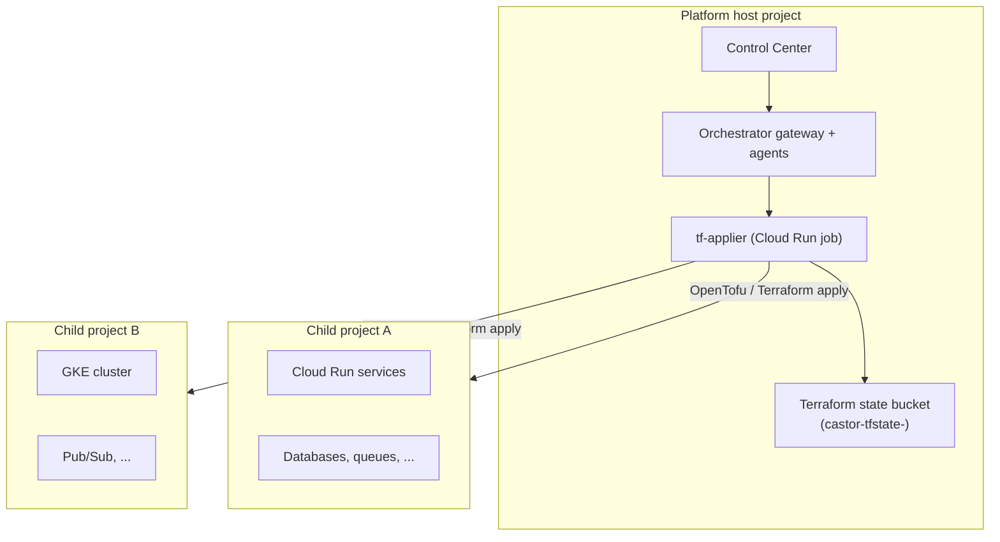

# StackVend User & Operator Guide

This guide explains how to use the StackVend **Control Center**: creating workloads, following the build pipeline, handling approvals, and the day-2 operations available once a workload exists.

For short task-by-task answers, open the **Guide** tab in the Control Center (the same text as the [Quick Guide](quick-guide.md)).

> **Public preview.** StackVend is not production-ready. Generated code and infrastructure should be reviewed by a person before you rely on them, and destructive actions (decommissioning in particular) delete real cloud resources. Screen layouts change often; where this guide differs from what you see, the UI is right.

---

## Contents

1. [Concepts](#1-concepts)
2. [Signing in and roles](#2-signing-in-and-roles)
3. [The Control Center tabs](#3-the-control-center-tabs)
4. [Creating a workload](#4-creating-a-workload)
5. [Following the pipeline](#5-following-the-pipeline)
6. [Day-2 operations](#6-day-2-operations)
7. [Settings](#7-settings)
8. [FAQ](#8-faq)

---

## 1. Concepts



* **Platform host project.** Runs StackVend itself: the Control Center, the agents and MCP tool servers, Firestore, and the Terraform state bucket.
* **Child workload projects.** Every workload is deployed into its own Google Cloud project, giving it separate IAM, networking, quotas and billing attribution.
* **Agents.** A lead architect and red-team critic design the workload, a lead developer and specialist junior developers write it, deterministic gates and a QA stage check it, and FinOps and SRE components watch it after deployment. See [Overview](overview.md).
* **Workload repository.** Each workload has its own Git repository (on GitHub or on the serverless Git provider) containing application code in `apps/<service>/`, infrastructure in `infra/workload/`, and workflows in `.github/workflows/`. You can clone it and edit it like any other repository.

---

## 2. Signing in and roles

Open the Control Center URL for the `product-control-center-ui` service (see the [Quickstart](quickstart.md)) and sign in with an authorized Google account. Behind Direct IAP (the installer's default) that must be an account of your Google Cloud organization (Google Workspace or Cloud Identity); a personal Gmail account is refused (see [Known limitations](known-limitations.md#private-iap-apps-admit-only-organization-accounts)). The account that installed the platform (or the configured `admin_email`) is created as an administrator.

| Role | Can do |
| :--- | :--- |
| `ADMIN` | Everything, including platform settings, user management, decommissioning and approvals. |
| `WORKLOAD_MANAGER` | Submit feature requests for, and manage, the workloads assigned to the user. Cannot create workloads or change platform-wide settings. |
| `VIEWER` | Can view the workloads assigned to the user, except their Terraform state outputs (shown to Workload Managers and administrators only). |

Creating workloads is an administrator action. Access control is stored in Firestore; the exact permission of each action is enforced by the API (see `apps/control-center/auth.py` and `routes/`).

---

## 3. The Control Center tabs

| Tab | What it shows |
| :--- | :--- |
| **Multi-Agent Pipeline** | The roster of agents and their configuration and activity. |
| **Flight Deck** | Live view of running pipeline executions: current stage, logs filtered by agent persona, rate-limit cooldown status, and an abort control. A badge shows the number of active executions. |
| **HITL Approvals** | Queue of decisions waiting for a human (see below). A badge shows pending items. |
| **Workloads Catalog** | All workloads, with filters for deployed, decommissioned and archived workloads and for sandboxes, plus per-workload details, budget and spend, feature requests, plans, and lifecycle actions. |
| **StackVend Assistant** | A conversational assistant for questions about the platform and your workloads. |
| **Guide** | A self-contained quick reference for everyday tasks (what to click, who can do it, what happens), with a table of contents. Its content is the [Quick Guide](quick-guide.md) without the links to these documents; administrators also see the administrator-only sections. |
| **Settings** (admins) | Platform settings, install warnings, GCP folders, network ledger, golden modules and bundles, agent skills and prompts, quotas, users, and the emergency stop. See [Settings](#7-settings) and the [Settings Reference](settings-reference.md). |

### Workload details

Selecting a workload opens its details: status, linked Google Cloud project, repository, budget versus spend, the deployed cloud assets read from Terraform state, build plans and architecture documents (stored in the workload's `docs/planning/` directory), feature requests, an architecture topology diagram, and IaC drift information with an *Upgrade IaC* action when newer golden-module versions exist.

---

## 4. Creating a workload

Choose **New Workload** in the Workloads Catalog. There are two creation modes.

### Agent mode (specification-driven)

Describe what you want in text, or upload a document. Supported upload formats are PDF, DOCX, Markdown, plain text, JSON and YAML, up to 25 MB. The Control Center extracts the text, suggests a slug and title, and checks the text for sandbox intent. You then review and submit.

Common fields: workload ID (a lowercase slug), title, monthly budget, VCS provider (GitHub or serverless Git), IaC engine (OpenTofu or Terraform), target folder, and governance options:

* **Require human code review**: pull requests wait for a person instead of auto-merging.
* **Require plan approval**: the architecture plan must be approved before developers write code.
* **Sandbox**: mark the workload as temporary (30-day default lifespan). See [Workload Lifecycle](workload-lifecycle.md).
* **Budget breach policy**: what happens at 100 percent of budget.
* **Region**: one of Settings **Approved Deployable Regions** (the default region is selected first). The workload's
  services, images and builds run there, and it keeps that region. Express mode offers the same list. A region outside
  the list is refused (`REGION_NOT_APPROVED`), and so is a region the chosen baseline does not allow
  (`REGION_PROFILE_CONFLICT`).
* **Security controls baseline** (the compliance profile): see [Choosing a compliance profile](#choosing-a-compliance-profile).

### Choosing a compliance profile

The compliance profile decides which regulatory controls the workload must meet. You choose it; StackVend never
guesses it from the words in your specification. A spec that mentions patients, credit cards or Europe is still a
**Standard** workload unless you pick a regulated profile.

The create form calls this field **Security controls baseline**. A baseline is a set of technical controls, not a
compliance status: FedRAMP, HIPAA and CJIS compliance require an Assured Workloads folder of that regime. Choosing a
baseline in an ordinary folder applies that baseline's technical controls (customer-managed encryption keys, audit
logging, allowed regions) but does not make the workload compliant. The workload catalog and the workload details page
show the difference:

| Shown | When |
| :-- | :-- |
| `Compliance: <regime> (Assured Workloads)` | The profile is the parent folder's Assured Workloads regime (the run recorded `ASSURED_WORKLOADS_FOLDER`). |
| `Controls: <regime> baseline (not a compliance environment)` | Any other regulated profile: chosen in an ordinary folder, chosen stricter than the folder's regime, or recorded before StackVend stored where the profile came from. |
| `Standard` | No regulated profile. |

Before the first compliance step of a run, and after you change the selection, the label shows the selection in the
`Controls: ... baseline` form until the next run decides it.

| Profile (`compliance_profile`) | Use it for |
| :-- | :-- |
| *(unset)* or `STANDARD` | Ordinary workloads. Default Google encryption, no extra controls. |
| `HIPAA` | Protected health information (PHI). |
| `FEDRAMP_MODERATE` / `FEDRAMP_HIGH` | US federal workloads at that FedRAMP level. |
| `CJIS` | Criminal justice information. |
| `EU_REGIONS_AND_SUPPORT` | Data that must stay in EU regions. |
| `PCI_DSS` | Real cardholder data. A store that only uses a payment provider's mock or test keys does not need it. |

How the profile is decided:

> **Assured Workloads folders are not detected on today's installs.** Step 1 below needs the compliance server's
> account to list the organization's Assured Workloads (`assuredworkloads.workloads.list` at organization level), and
> the installer does not grant that yet. Until it does, every run reads the folder as an ordinary folder, the profile
> you select applies (step 2), and the run's compliance answer records why the folder was not checked
> (`assured_workloads_check`: `AW_CHECK_FAILED` with the HTTP status, or `AW_CHECK_ORG_UNKNOWN`). In an Assured
> Workloads folder, select the folder's regime yourself. See [Known limitations](known-limitations.md#regulated-compliance-profiles-are-not-available-yet).

1. If the target folder is an Assured Workloads folder:
   * its regime must be one StackVend maps: HIPAA, FedRAMP Moderate, FedRAMP High, CJIS or EU Regions and Support.
     Any other regime (for example IL4 or ITAR) is refused with HTTP 422 (`UNMAPPED_ASSURED_WORKLOADS_REGIME`) and
     nothing is built;
   * if you selected a different profile, the **stricter** of the two applies, and the run records a note naming both.
     Strictness, from least to most strict: `STANDARD`, `PCI_DSS`, `HIPAA`, `FEDRAMP_MODERATE`, `CJIS`,
     `FEDRAMP_HIGH`. `EU_REGIONS_AND_SUPPORT` allows only EU regions, so it cannot be combined with a US profile: that
     pair is refused with HTTP 422 (`COMPLIANCE_PROFILE_CONFLICT`).
2. Otherwise the profile you selected applies. It is stored on the workload, so later runs (feature requests,
   retriggers, automatic SRE and refactor runs, infrastructure-only deploys) keep it until you choose another one.
3. Otherwise the workload is `STANDARD`. The run records this as `DEFAULT_STANDARD`.

Changing a stored regulated profile to a less strict one (for example `HIPAA` to `STANDARD`, or a US profile to EU
Regions and Support) is not applied right away. StackVend creates a **Compliance profile downgrade** card in **HITL
Approvals** and refuses the request (HTTP 409, `COMPLIANCE_DOWNGRADE_REQUIRES_APPROVAL`) until an administrator approves
the card. Approving stores the new profile, and the next run uses it. Rejecting keeps the old profile. Moving to a
stricter profile needs no approval.

**Express mode** does not support regulated profiles: creating an Express workload with any profile other than
`STANDARD` is refused with HTTP 422 (`EXPRESS_REGULATED_PROFILE_UNSUPPORTED`). Use Agent mode for regulated workloads.

A regulated profile adds required tasks to the plan (customer-managed encryption keys, Data Access audit logging, and
for PCI DSS private ingress behind a load balancer). The apply is refused if the plan does not meet the profile, for
example a resource without a customer-managed key or in a region the profile does not allow. `PCI_DSS` requires
internal-only ingress, which this release cannot set on Cloud Run services: a `PCI_DSS` plan with a Cloud Run service
stops at the compliance stage with `COMPLIANCE.PRIVATE_INGRESS_UNSUPPORTED`, before anything is built or changed (see
[Known limitations](known-limitations.md#cloud-run-services-cannot-be-made-internal-only-yet)). Choose a regulated
profile only when the workload really needs it.

The value must be exactly one of the names in the table (upper case). Anything else, for example `hipaa` or `PCI`, is
rejected with HTTP 422 and nothing is built.

If your specification uses words that are often associated with a regulated profile, the compliance step records an
advisory note (for example "the spec mentions 'credit card': set compliance_profile=PCI_DSS explicitly if it applies")
in the run's compliance audit record. The note never changes the profile.

### Via Google Drive (spec intake)

StackVend can also build a Google Doc that is dropped in the configured Drive inbox folder (`INBOX_FOLDER_ID`; it is moved to `IN_PROGRESS_FOLDER_ID` when picked up). It builds only documents that meet all of these rules:

* **Owner.** The document's owner, as Drive reports it, is an active user on the Users page with the Administrator, Workload Manager or legacy Approver role. The address must match exactly. Viewers, people who are not users, the platform service account, and shared-drive files (they have no owner) are not accepted.
* **Workload.** The title gives the workload id (for example `NEW_PRODUCT_SPEC: Order Service` becomes `order-service`). It must be a valid id: lowercase letters, digits and hyphens, at most 63 characters (a `/` or an empty title is refused with `SPEC_PRODUCT_ID_INVALID`; a folder tag in the title is part of the id, so put a folder id tag in the description instead). When that workload already exists, the owner must be an Administrator or be assigned to it, as in the Control Center (`SPEC_WORKLOAD_NOT_ASSIGNED`). A new workload can be started by any of the roles above; a Workload Manager who starts one is assigned to it as its Workload Manager (shown as `USER_ACCESS_AUTO_ASSIGNED` in the Access Control audit), so their later specs for it are built. The StackVend platform itself is never a target (`SPEC_TARGET_PLATFORM_WORKLOAD`).
* **Folder.** A folder tag in the title or description (`[folder: Finance]`, `[folder: 123456789012]`) or a `target_folder` file property must name an active managed folder. Ids must match exactly. Names must match the whole name, ignoring case, and identify only one folder. Without a tag, the managed folder with the same name as the Drive parent folder is used, then the single default managed folder.
* **Skipped documents.** Anything else stays in the inbox and is listed with a reason (`SPEC_SUBMITTER_UNAUTHORIZED`, `TARGET_FOLDER_NOT_MANAGED`, `SPEC_PRODUCT_ID_INVALID`, `SPEC_WORKLOAD_NOT_ASSIGNED`, `SPEC_TARGET_PLATFORM_WORKLOAD`, or `SPEC_WORKLOAD_ALREADY_REQUESTED` when another document of the same poll already asked for that workload) on the poll response and in the document's `spec_ingestions` audit record, under `last_skip`. It is checked again on the next poll.
* **Unreadable checks.** If the user list, the folder list or the workload list cannot be read, the whole poll is skipped (`SPEC_INTAKE_UNAVAILABLE`) and nothing is moved.
* **Build event not sent.** If the build event cannot be sent after the document was moved to the in-progress folder, it is moved back to the inbox and listed with `SPEC_PUBLISH_FAILED` (the next poll tries again).

**Keep edit access to the inbox folder limited to authorized submitters.** StackVend trusts the document's Drive owner, and the owner is not always the person who put the document in the inbox. Inside a Google Workspace organization, ownership can be transferred to another user of the organization immediately, without that user accepting. Anyone who can edit a document can also change its content. So the sharing of the inbox folder (`01_Inbox_Requests`) is the control: only authorized submitters and the platform service account should hold edit access to it. Check the folder's sharing before you enable Drive intake.

Drive folder auto-discovery (Settings, Platform Governance, *Drive Folder Auto-Discovery*) is off by default. When it is on, the poller searches for `01_Inbox_Requests` folders shared with the platform service account and polls each one whose owner is an authorized submitter, in addition to the configured folders (a folder that is both configured and discovered is polled once). A `/poll` request that names its own inbox or in-progress folder gets the same owner check, unless it names the configured folders. If no active Administrator or Workload Manager is listed, the Settings card shows a warning and every Drive spec is skipped.

### Express mode (registered modules)

Choose **Express Registered Modules** to assemble a workload from golden modules (for example Cloud Run services, event workers, databases, an optional VPC) without a free-text specification. This skips most of the AI design work and uses the module catalog directly.

Express workloads answer **Who may use this app** like Agent mode (see [Choosing who may use the app](#choosing-who-may-use-the-app)), and get the same private default when the answer is left out. The answer applies to every Cloud Run service of the workload.

### Via the API

`POST /api/workloads` accepts the same fields (`product_id`, `title`, `spec_content`, `vcs_provider`, `iac_engine`, `compliance_profile`, `creation_mode`, `is_sandbox`, ...). Authentication is the same as for the UI.

A spec intake event (Pub/Sub `spec-intake-events`) may also carry `compliance_profile` with the same values; an invalid
value is refused with 422 and the event goes to the dead-letter topic.

### Choosing who may use the app

In Agent and Express modes the form asks **Who may use this app**. Your answer is stored with the workload (`workloads/{product_id}.access`) and decides how the generated service is exposed. StackVend never works it out from the specification text and never adds people for you.

| Choice | Who can reach the app | What you enter |
| :-- | :-- | :-- |
| **Private: Google sign-in (IAP)** (default) | Only the listed people and groups, after Google sign-in through Identity-Aware Proxy | One member per line |
| **Private: IAM callers only** | Only the listed identities, calling with Google credentials (for APIs, no browser sign-in) | One member per line |
| **Public** | Anyone on the internet; the app itself handles sign-in | A yes/no answer (below) |

Members must be written exactly as IAM members: `user:ana@example.com`, `group:team@example.com`, `serviceAccount:caller@my-project.iam.gserviceaccount.com` or `domain:example.com`. Nothing is prefixed or corrected for you, and `allUsers`, `allAuthenticatedUsers`, organization customer ids (`C0...`) and other kinds are refused. The form pre-fills you (`user:<your sign-in email>`) so you can confirm it; remove or add members as needed. A private app needs at least one member.

**Private: Google sign-in (IAP) admits organization accounts only.** IAP uses a Google-managed OAuth client, which admits only accounts of your Google Cloud organization (Google Workspace or Cloud Identity). A personal Gmail account is refused with "You don't have access" even when it is listed, so list organization accounts (or a `group:` / `domain:` of your organization). The create form and the **Edit access** card warn (without refusing) when a `user:` member for Private (IAP) is a personal Google account, that is, an address at `gmail.com` or `googlemail.com`. StackVend does not know your organization's own domain, so an account of another organization is not flagged. **Private: IAM callers only** does not use IAP sign-in. A custom OAuth client for personal accounts is a future feature (see [Known limitations](known-limitations.md#private-iap-apps-admit-only-organization-accounts)).

For **Public**, the form asks one required question with no pre-selected answer: *Does this app handle money, personal data, or other customers' data?* Your answer is stored with the workload. **Yes** means the app must never use a sign-in client shared with other apps on this install; **No** allows a shared one. In this preview neither answer adds Google sign-in to the app: there is no shared Google sign-in for generated apps and no app gets its own Google sign-in client yet (see [Known limitations](known-limitations.md#generated-public-apps-have-no-shared-google-sign-in-yet)), so a public app handles its own sign-in, if it needs one. If you need Google sign-in in front of the app today, choose Private (IAP).

Through the API, send the answer as `access`:

```json
{"product_id": "team-wiki", "spec_content": "...",
 "access": {"mode": "PRIVATE_IAP", "invoker_principals": ["user:ana@example.com", "group:wiki-editors@example.com"]}}
```

`mode` is `PRIVATE_IAP`, `PRIVATE_IAM` or `PUBLIC_APP`; `PUBLIC_APP` takes `"tenant_isolation_required": true` or `false` and no members, and the private modes take no `tenant_isolation_required`. An invalid answer is refused with HTTP 422 and nothing is created. If you leave `access` out of a **new** workload, it gets the platform default: **Private: Google sign-in (IAP)** (stored with `"source": "platform_default"`), listing the submitter when StackVend itself verified who that is: the signed-in Control Center user who created it (or who promoted it with *Deploy to New Folder*; a promotion never copies the source workload's access), or, for Google Drive intake, the spec file's **owner** as Drive reports it. The owner is listed, not whoever moved the file into the inbox folder; files in shared drives have no owner, so nobody is listed for them. Nothing written in the specification, a file name or a request is ever listed, and service accounts are never listed. Who was listed by default, and how it was verified, is kept on the workload as `access_default_submitter`; an administrator's later access change replaces the record but keeps that entry as history. When no verified submitter is known (for example an intake from any other channel, a shared-drive file, or a single-document Drive intake), nobody is listed and the build stops with `ACCESS_POLICY_INCOMPLETE` before any code is generated until an administrator lists who may use it (see the PATCH below). It is never made public because nobody answered. Public is always an explicit choice (`"mode": "PUBLIC_APP"`). An **existing** workload keeps the record it has (or keeps having none); leaving `access` out never changes it.

Rules that keep the record honest:

* **The stricter answer wins.** If you choose Public but the compliance review requires private access (IAP, or no unauthenticated access), the build stops with `ACCESS_COMPLIANCE_CONFLICT` before any code is generated; choose a private mode with members (or change what the compliance review is answering). A private choice under a public compliance answer is used as you chose it.
* **App administrators (Private: Google sign-in (IAP), Agent mode).** A generated app with a privileged role (for example SuperAdmin) gives that role to its app administrators, which StackVend sets on its Cloud Run services as `STACKVEND_APP_ADMIN_EMAILS`. In this release they are the signed-in Control Center account that created the workload (kept on the workload as `verified_submitter`), or the verified submitter of a platform-default workload, when that exact account is also a `user:` member; otherwise nobody, and the workload record shows `APP_ADMIN.NONE_CONFIGURED`. There is no field to change them yet (see [Known limitations](known-limitations.md#app-administrators-of-a-private-iap-app-cannot-be-changed-yet)).
* **Express mode** applies the record to every Cloud Run service it deploys: Private (IAP) turns on Google sign-in through Identity-Aware Proxy for the listed members, Private (IAM) lets only the listed members call it, and Public lets anyone reach it. A new Express workload created without `access` gets the same private default as above (listing you, the signed-in submitter). A private record that lists nobody stops the Express build with `ACCESS_POLICY_INCOMPLETE` before any code is committed; set the record (PATCH below), then submit the Express workload again. A Cloud Run instance's own `allow_unauthenticated`, `enable_direct_iap` or `authorized_invoker_members` parameter must match the record, or the request is refused with HTTP 422 `EXPRESS_ACCESS_CONFLICT` (when the record is already stored, the build stops with that reason instead); for a public service, choose `"mode": "PUBLIC_APP"`. An Express workload created before this change has no record and keeps deploying as it did (public unless an instance set `allow_unauthenticated` to `false`); give it a record with the PATCH below to make it private.
* **Re-creating** a workload whose product id already has a *different* access record is refused (409); change it with the administrator PATCH below, which is audited.

**Setting or changing access later (administrators).** In the Control Center, open the workload from **Workloads Catalog**: administrators see a **Who may use this app** card on its page with the current record (the mode, the people and groups allowed, or the Public question's answer; who changed it last and when; and whether a widening is waiting for a plan approval). **Edit access** opens the same choices as the create form, plus an optional reason for the audit log; **Save access** replaces the record as a whole. If the change lets more people in, the card explains that it is a widening and asks you to confirm it (**Confirm widening and save**); the next run then waits for a plan approval (see below). Any other refusal is shown as the server sent it. Other roles do not see the card. **A saved change applies on the next relaunch.** Every deployment applies the workload's *current* access record, not the copy written into its generated code when it was built: StackVend writes the mode and the members into a platform-owned variable file of the deployment (never into the repository), which takes precedence over the committed values, and records a `WORKLOAD_ACCESS_APPLIED` entry in the workload's audit log when the deployment succeeds. So for a private app (Private: IAM callers only, or Private: Google sign-in (IAP)), removing or adding people, or switching between the two private modes, applies with **Fast-Path Deploy**, without regenerating code; after a successful run, **Auto** picks Fast-Path Deploy by itself when the access record was saved after that run completed as a change between private records, with no widening waiting for approval, no feature request created or changed since the run started, and the workload is not Express. Like an explicit Fast-Path Deploy, this re-applies the code on the workload's default branch as it is (no code is generated and no QA runs). A change to or from **Public**, or to a Public app, needs **Full Swarm Rebuild**: a Public app's sign-in is part of its generated code, so a deployment never opens a private app through a variable (Fast-Path Deploy keeps the committed settings of a Public record; after a change from Public to private, a Fast-Path Deploy already makes the service private, but the app keeps its own sign-in code until the rebuild). A **widening** (below) first needs its plan approval, which only a full build asks for: until then Fast-Path Deploy is refused (`ACCESS_WIDENING_PENDING` at the deploy-only gate, `ACCESS_WIDENING_UNAPPROVED` at deployment). A deployment also stops, before anything is built, when the stored record is not valid (`ACCESS_POLICY_INVALID`), lists nobody for a private app (`ACCESS_POLICY_INCOMPLETE`) or cannot be read (`ACCESS_POLICY_UNAVAILABLE`). Express workloads are unchanged: their access is applied when the Express form is submitted again. Through the API, `GET /api/workloads/{product_id}/access` returns the current record (administrators only; `access` is `null` when none is set, `access_valid` says whether the stored record is valid, `access_widening_pending` whether a widening waits for its plan approval), and `PATCH /api/workloads/{product_id}/access` takes the same body (plus an optional `reason`, and `"source": "migration"` for a backfill). It replaces the workload's record as a whole, writes the previous and new record to the workload's audit log, and is refused for anyone who is not a platform administrator. This is how you answer a run that stopped with `ACCESS_POLICY_INCOMPLETE`, `ACCESS_POLICY_REQUIRED` or `ACCESS_COMPLIANCE_CONFLICT`: set the record, then re-trigger the workload. Errors write nothing: 503 when the workload store is unavailable, 404 for an unknown workload, 422 for an invalid body, 500 when the write fails.

**Widening needs confirmation and a plan approval.** A change that lets more people in is a *widening*: a less restrictive mode (the order, narrowest first, is Private: IAM callers only, then Private: Google sign-in (IAP), then Public), a member that the current private record does not list, or setting a record where none (or no valid one) exists. Membership is compared exactly as written: replacing `domain:example.com` with one user of that domain still counts as adding a member. A widening needs `"confirm_widening": true` in the body; without it the answer is HTTP 422 with `error_class` `ACCESS_WIDENING_UNCONFIRMED` (and the list of `changes`), and nothing is written. A confirmed widening is written to the audit log with `widening: true`, and the workload's next run stops at the plan-approval gate (reason `ACCESS_WIDENED`) until someone approves the plan in Control Center -> Approvals. Rejecting the plan, asking for rework or letting it time out keeps that requirement for the run after; only an approval clears it. A resume (`RESUME_DEVELOPER`) is refused while the widening is unapproved, and a run that was already past the gate when you widened stops with `ACCESS_WIDENING_UNAPPROVED` before any code is generated. Removing members, moving to a stricter mode, or sending the same record needs no confirmation (and does not clear a pending approval). **A widening cannot be withdrawn:** narrowing the record back to what it was, even exactly, leaves the pending approval in place, so the next run still waits for a plan approval; a pending widening is cleared only by approving a run's plan. The approval card shows the mode before and after and the members added since the last approved record (if you widen twice before an approval, it shows both widenings against that record). Changing only the Public sign-in question (the A8 answer) is not counted as a widening. If the workload changed between the moment your change was read and the moment it is written (for example because of another administrator's change, or any other update to the workload), the change is refused with HTTP 409 and nothing is written; send it again. The create form and `POST /api/workloads` cannot give an **existing** workload its first access record (HTTP 409): use the PATCH, which confirms and audits it.

---

## 5. Following the pipeline

Once submitted, the Flight Deck shows the run. The stages are described in [Overview](overview.md) and [Platform Internals](platform-internals.md); in short:

1. **Pre-discovery**: organization policies and regional quotas.
2. **Architect consensus**: architecture plan and task DAG, reviewed by a red-team critic.
3. **Compliance and cost**: an advisory compliance review and a rough cost estimate.
4. **Plan approval**: when required for the workload (or by the platform's plan-approval settings), the run pauses until an operator approves the architecture plan. It also pauses, whatever those settings say, for an over-budget cost estimate, a policy conflict, an unapproved access widening, and a Public app whose plan has a Cloud Run service that only Pub/Sub push calls (that service would be reachable from the internet; see [Known limitations](known-limitations.md)).
5. **Project vending**: the child project and repository are created.
6. **Developer swarm**: code, infrastructure and tests are generated in waves.
7. **Preflight, verifier and QA**: deterministic checks, then tests and scans in a sandbox. A requirement the platform meets itself is not judged against the generated code: a budget cap in the specification is met by the workload's monthly budget ceiling, and a sandbox lifespan by the workload's sandbox record (while it has not ended). A build file or build step the plan asks for (for example a Cloud Build `cloudbuild.yaml` that runs Buildpacks) is met by the platform, which builds every container image itself with Cloud Native Buildpacks and writes the CI files itself (such a finding counts for an infrastructure or CI/CD task of the plan). A finding the workload cannot fix because of a documented platform limitation (today: restricting who may call one Cloud Run service of a Public app, see [Known limitations](known-limitations.md#cloud-run-services-cannot-be-made-internal-only-yet)) is an advisory. When QA's reviewer still lists such a finding for an infrastructure task of the plan (or for no single task), the QA summary and the release certificate show it as "Satisfied by the platform" or "Documented platform limitation, not a code defect (advisory)", and it fails the build neither at QA nor at release. It still fails the build when the workload has no such record, in a Private workload (for the access finding), or when it belongs to an application-code task. Of the reviewer's output, only the findings it lists fail a build (failed tests and scans still fail it too); its adherence and grounding scores are shown in the QA summary and the release certificate as information. An adherence score below 0.80 with nothing listed is reported as an unavailable reviewer (no verdict), never as a pass. Check that the recorded ceiling is the amount the specification asks for.
8. **Release**: pull request; the run pauses for human approval when human review is required.
9. **Deployment**: OpenTofu/Terraform apply by the `tf-applier` job; the service URL and project ID appear in the workload details. If the deploy could not read the service URL (from its outputs or the Cloud Run API), the workload shows **URL unknown** with the reason instead of a guessed address.

**Environment variables the platform does not set.** After a build passes its checks, the workload page lists every environment variable a Cloud Run service's code reads (`os.getenv`, `os.environ.get`, `os.environ[...]` with a fixed name) that the platform does not set on that service: the service, the file and line, and the default the code uses instead (or that there is none). These are warnings: they never stop the build or the release. Check each one before you approve a release, because the sandbox tests mock the cloud and cannot show a wrong value; for example, a project id read from `GCP_PROJECT` with the fallback `"local-project"` makes every Google API call go to a project that does not exist (the platform sets `PROJECT_ID`, `GCP_PROJECT_ID` and `GOOGLE_CLOUD_PROJECT`). A read in the fallback of another read whose variable the platform sets is not listed, because its value is never used. Where the platform cannot tell which variables a service gets (GKE and Compute Engine services, or a variables file that may change them), the page says so instead. See [Known limitations](known-limitations.md).

### Approvals

When the platform needs a decision it creates an approval record. In **HITL Approvals** you can approve (the pipeline resumes), reject, or request rework with feedback. The same decisions are available through `POST /api/approvals/{id}/decision`.

**Serverless Git releases merge only the commit QA tested.** A release of a workload that does not require human code review merges by itself on Serverless Git as on GitHub, and the merge names the commit QA tested: if the release branch changed after QA, the git server refuses the merge, nothing is merged, and the release waits on an approval card that says the merge was refused (approving it is refused too, and the run ends with `RELEASE_FAILED`; re-run the workload). StackVend first asks the git server whether it makes this check. If it does not (a git server older than this release) or cannot be asked, the release waits for an approval instead of merging, and the card says why (`hitl_reason_code` `SERVERLESS_GIT_SOURCE_CHECK_UNSUPPORTED` or `SERVERLESS_GIT_SOURCE_CHECK_UNCONFIRMED` on the approval record); update the git server to let releases merge by themselves. The same pin applies to approving an **Upgrade IaC** card on Serverless Git: the upgrade is merged at the upgrade commit, and a branch that changed after it is refused (the run ends with `RELEASE_FAILED`).

If approving a release card merges nothing because StackVend refused before merging (for example the card has no PR ledger entry, or names another repository), or because the Serverless Git server answered with an error, the card says the merge failed and can be decided again once the cause is fixed. If the merge was attempted and failed (GitHub refused or did not merge the pull request, or the Serverless Git main branch moved since the branch was cut), the run ends at once with `RELEASE_FAILED` (or `MAIN_MOVED`) instead of waiting for the 24-hour approval timeout; the card is closed with that status. Fix the cause, then re-run the workload. If the run could not be told, the card shows *Workflow callback failed* and can be decided again.

### If a run fails or stalls

The Flight Deck keeps the logs. Typical causes are model rate limits (the platform waits out a cooldown and resumes), exhausted quotas, invalid generated IaC, and permission problems in the host or child project. You can abort a run, and re-trigger a workload or feature request from the details view once the cause is fixed. A run that stops with `ACCESS_POLICY_INCOMPLETE` or `ACCESS_POLICY_REQUIRED` needs the workload's access answer (as does `ACCESS_COMPLIANCE_CONFLICT`): see [Choosing who may use the app](#choosing-who-may-use-the-app). The repository's `/stackvend-troubleshoot` and `/stackvend-diagnose-workload` skills describe a systematic way to investigate with an AI coding assistant.

**A run that stops after QA keeps what QA tested.** When a rebuild after a QA failure stops instead of repairing (for example `QA_FINDING_ON_PLATFORM_RENDERED_FILE` or `QA_FINDING_ON_UNOWNED_FILE`, or any other typed failure of the developer stage, including one at commit time such as `PRECOMMIT_VERIFY_FAILED`, a moved base branch or `VCS_CREDENTIAL_UNAVAILABLE`), StackVend leaves the tested branch and its pull request as they were, and the failure message names the branch, the commit and the pull request (an untyped failure, such as a rejected push, keeps them too and names them in the gateway log). Earlier StackVend pull requests of the workload are closed only after a later build has committed its own files; if that build's stage has already timed out or been stopped by then, they stay open until the next build that commits.

---

## 6. Day-2 operations

### Feature requests

From a workload's details, submit a feature request with a title, change type, priority and description. The developer swarm creates a branch, implements the change with tests and opens a pull request (or merges automatically if review gates are disabled).

### Per-workload policies

`PATCH /api/workloads/{product_id}/policies` (administrators; also on the workload's page, *Workload Governance & Autonomy Controls*) controls autonomous behavior:

| Policy | Effect |
| :--- | :--- |
| `code_freeze` | Stops the automatic runs that change the workload's code (SRE auto-healing and the code scanner) and refuses **Upgrade IaC** (423); budget enforcement and the sandbox expiry sweep still apply. Builds, retriggers and feature requests an operator starts are not blocked. New workloads start frozen while the platform setting *Freeze new workloads by default* is on (the default; see below). An [emergency stop](settings-reference.md#emergency-stop) freezes every workload that is not decommissioned; resuming puts back the freeze and SRE auto-healing each one had before the stop. |
| `sre_auto_healing_enabled` | Lets the SRE sentinel start remediation workflows when runtime errors appear (no effect in this preview: see [Known Limitations](known-limitations.md#running-workloads-are-not-repaired-automatically)). On for a new workload; re-creating, re-vending or redeploying a workload keeps its current value (this and the next switch). |
| `refactor_scanner_enabled` | Controls whether the scheduled code-scan job may open pull requests for this workload. |
| `require_human_code_review`, `auto_merge`, `require_plan_approval` | Pull request and plan review behavior. The platform setting *Require Plan Approval for Every Run of Every Workload*, when on, applies to every workload regardless. |
| `budget_breach_policy` | What happens when spend reaches the workload's budget ceiling. |

**GitHub Actions deploy** (GitHub workloads only; the workload's page, *GitHub Actions Deploy* card, or
`PATCH /api/workloads/{product_id}/github-actions-deploy` with `{"enabled": true|false}`; administrators; every change
is written to the workload's audit trail). On by default: each service gets a `.github/workflows/deploy-<service>.yml`
that deploys the app's code from the workload's branch with the `sa-gh-deployer` account through Workload Identity
Federation, without StackVend's checks (see [Known Limitations](known-limitations.md#other-security-gaps-in-this-preview)).
Off: the next pipeline run commits no deploy workflow and deletes the existing `deploy-*.yml` files, and the next deploy
removes the workload's identity federation pool, provider and `sa-gh-deployer` (Google keeps the pool name reserved for
30 days; turning the switch back on within that time restores it), so every deploy goes through StackVend's pipeline.
A deploy of infrastructure code generated while the switch was on stops for an operator with
`APPLY.GHA_DEPLOY_SWITCH_NOT_IN_IAC` (no automatic developer run) until the workload's next pipeline run regenerates
it. The create form (**GitHub Actions deploy**) and the create API (`github_actions_deploy`)
set it for a new workload; Serverless Git workloads have no such path and refuse `false`.

### New workloads start frozen

Settings, Platform Governance, *Freeze new workloads by default* (`governance.freeze_new_workloads`) is **on** by default. Every new workload (created from the Control Center, promoted to a folder, or submitted as a Google Doc spec) then starts with Code Freeze on:

- **The first build and deploy run normally**, and so do the builds, retriggers and feature requests you start.
- **The automatic runs that change its code are blocked** until you unfreeze it: SRE auto-healing and the code scanner's pull requests, and also the **Upgrade IaC** action. Budget enforcement (the breach policy, such as scale to zero or quarantine) and the sandbox expiry sweep still apply to a frozen workload.
- **To unfreeze**, open the workload, find *Workload Governance & Autonomy Controls* and click **Unfreeze** (administrators). While the workload is frozen the page greys out the other governance controls on that card, so unfreeze first to change them.
- An administrator can turn the setting off; new workloads then start unfrozen. The setting never changes existing workloads, and re-creating or redeploying a workload keeps its current freeze. See [Settings Reference: Freeze new workloads by default](settings-reference.md#freeze-new-workloads-by-default).

### Sandboxes: extend, promote, decommission

* **Extend (+30 days)**: limited to 3 extensions and 90 cumulative days.
* **Promote to Production**: removes the expiry.
* **Decommission**: deletes the workload's child Google Cloud project and takes spend to zero. Git repositories and Terraform state are kept; redeploying creates a new child project. Decommissioned workloads can then be archived.

### Budgets and spend

Budget ceilings and breach policies are set per workload: the ceiling on the create form (pre-filled with the platform's *Default Monthly Budget Ceiling*, $40 unless an administrator changed it), the breach policy on the create form or the workload's page (default: the platform's *Default Budget Breach Enforcement Policy*). Spend is synchronized nightly and can be refreshed on demand per workload. The breach policy acts on Cloud Billing budget notifications, and StackVend does not create budgets yet, so create one for each workload's project yourself (see [Known Limitations](known-limitations.md#no-billing-budgets-are-created-for-workloads)). See [Settings Reference: FinOps](settings-reference.md#3-finops--budget-controls).

### IaC upgrades

When golden modules change, the catalog flags workloads with outdated IaC. The upgrade action opens a pull request in the workload repository with the new module versions (no AI is involved); review the diff and merge it to take the upgrade. Until then the deploy applies the committed modules. The action is refused while the workload has Code Freeze on; unfreeze it first.

The pull request changes only the upgraded modules' own directories: it updates and adds their files and deletes the module `.tf` files that the new version no longer has. Application code, root IaC, human overrides and modules that were not upgraded are never touched. A `.tf` file you added yourself inside a vendored module directory is deleted by the upgrade of that module (the directory belongs to the platform); put your own changes in `infra/human.tf` or `infra/human_override.tf` instead. Before anything is committed, every upgraded Terraform file must parse; if one does not, the upgrade is rolled back and the error names the file (see [Known Limitations](known-limitations.md) for the parser the Control Center uses). On Serverless Git, a pull request that deletes files needs a git server deployed with this change; an older git server refuses it and nothing is committed.

### Typed infrastructure (generate mode)

Settings, Platform Governance, *Typed infrastructure (generate mode)* (`governance.iac_intent_generate`) is on by default. The agents describe a new workload's infrastructure as a typed list of approved building blocks (`infra/workload/iac_intent.json`), and the platform checks it and writes the Terraform from it, instead of the agents writing Terraform directly. An administrator can turn it off; new workloads then get agent-written Terraform.

- **The default applies only when nothing is saved.** A fresh install is on. A value an administrator saved, on or off, is kept: the default never overrides it.
- It applies to **new workloads only**, for builds that start after the setting is saved (allow up to a minute).
- **Existing workloads keep their path.** A workload already built this way stays on it, even if the setting is turned off later; a workload built with agent-written Terraform keeps that.
- Workloads that need **Cloud SQL, Redis, AlloyDB, Vertex AI endpoints or Bigtable** are built this way too: the platform supplies the private network (with its Private Services Access range from the platform's IP address plan) and the Cloud Run connector where the service needs one. A Cloud SQL or AlloyDB database's password is kept in Secret Manager. Every service that uses the database gets the secret's id as an environment variable (`<DATABASE>_PASSWORD_SECRET_ID`, for example `POSTGRES_PASSWORD_SECRET_ID`; the `password_secret_id` attribute) and read access to that one secret, and the app reads the password from it at runtime. On AlloyDB the user is `postgres`. On Cloud SQL it is the database module's `db_user` (`app_user` unless the plan sets another).
- **Secret Manager secrets.** The architect's plan says who supplies each secret's value (`initial_value`). For a key the app makes and uses itself (`random`: a signing, HMAC or encryption key), the platform stores 64 random letters and digits as the secret's first version when it creates the secret, so the app can read it on its first deploy; the value never changes on later deploys. A credential from another system (`operator`), or a secret whose plan does not say, is created without a value. That is a warning, not a pause: it is kept with the run's plan decision and, when the plan waits for approval for another reason, the approval card lists the secret. For now an operator adds the value by hand in Secret Manager; a Control Center action for it is planned. See [Known limitations](known-limitations.md#secrets-from-other-systems-are-added-by-an-operator).
- **Turning it off affects new workloads only.**
- If the settings cannot be read when a new workload's build starts, that build uses today's path; the setting never stops a build.
- **Google APIs the code only calls.** A short approved list of Google APIs needs no infrastructure of its own: Vertex AI (Gemini), Document AI, Speech-to-Text, Cloud Translation, Cloud Vision, Natural Language and Text-to-Speech. For one of the first four the platform turns the API on and gives the workload's service account exactly one narrow role (Vertex AI User, Document AI API User, Cloud Speech Client or Cloud Translation API User); Cloud Vision, Natural Language and Text-to-Speech have no role of their own, so the platform only turns them on. No admin role is ever granted, and any other API asked for on its own is refused. A second grant of that same role to the service account, written by the agents next to the API entry, is refused too (`IAC.DUPLICATE_GRANT`) and repaired away, so the role is granted once.
- **Infrastructure the platform cannot generate yet.** If the agents asked for a building block that is not approved (including a Google API that is not on the approved list above) and a repair removed it, the workload page lists it as a warning after the build (a removed Google API entry is only ever a warning). If the architect's plan named that service (a resource in the plan's service map, or an API in its build plan) and nothing else in the build provides it, the build stops with `IAC.REQUESTED_SERVICE_DROPPED` instead of shipping without it. Before that stop, when the approved building blocks offer a way to provide what is missing (for example an API entry from the list above, or a golden module that needs that API), the agents get one repair attempt to add it; the build stops only if that attempt does not fix it.
- **When a deploy of such a workload fails** because OpenTofu rejects one of the building blocks, the automatic retry repairs that entry and edits only `infra/workload/iac_intent.json` (the application code is kept as committed, nothing is regenerated) and deploys again, within the usual retry limit. If the error is in a file the platform writes, the run stops with `PLATFORM_DEFECT` instead of rebuilding the workload; if it is in your own `human.tf`, `human_override.tf` or another override file, the run stops for an operator (`OPERATOR_ACTION_REQUIRED`), because the agents never edit those files. Other deploy errors (for example a failed `init`) are retried as before. The same applies when you relaunch a run whose deploy failed with **Resume Developer** (or Auto chooses it): the resumed run starts from that deploy's findings, and an intent repair starts from the files of the build that was deployed.

The change is saved like every other setting: administrators only, and recorded in the settings audit log.

---

## 7. Settings

The **Settings** tab is for administrators. Its sub-tabs are **Parameters** (the platform settings form, with status
and warning cards on top), **GCP Folders**, **Network & IPAM**, **Modules & Bundles**, **Agent Skills**, **Agent
Prompts**, **Cloud Quotas**, **Upgrades** (installed and newest release, release source, upstream sync), **Access
Control** (users and roles) and **Emergency Stop**. The
[Settings Reference](settings-reference.md) describes every control: what it does, its default, when it takes effect,
and what is risky.

The essentials:

* **Saving.** The Parameters form is saved as a whole with **Save Changes**. It is validated first (one bad value
  refuses the save), and every save or reset is recorded in the **Settings Audit History** (last 15 entries). Other
  services pick up a change within about a minute. **Reset Defaults** resets everything, governance switches and
  the platform region included.
* **Warning cards.** Missing billing permissions do not stop the install; without the deletion safety tag the installer asks first (answer **y** to continue). The cards
  at the top of Parameters say what is missing and give the exact fix. Without the deletion safety tag, StackVend
  cannot decommission projects, and a banner on every page says so until it is fixed. See [Install warning cards](settings-reference.md#install-warning-cards).
* **Governance switches.** *Maintenance Mode* stops new runs (running ones finish); *Strict Compliance Gates*,
  *Require Human Approval for Destructive Terraform*, *Force HITL for All New Workloads* and the plan-approval settings
  add human checks; *Drive Folder Auto-Discovery* is off by default and *Typed infrastructure (generate mode)* is on. Two
  information cards explain authorized Drive submitters and the private-by-default access of new workloads.
* **Platform-wide effects.** The platform region, the Platform BOM (package versions, Python version, Cloud Build
  settings), model choices and agent prompts apply to every workload, not just new ones. Change them with care.
* **Not every field is used yet.** Some fields (for example the FinOps thresholds, the default branch and the lock
  timeouts) are stored but not read by any service today; the reference lists them under
  [Known gaps](settings-reference.md#known-gaps-between-the-page-and-the-platform).
* **Emergency Stop** cancels running pipelines and freezes every workload that is not decommissioned. Resuming lets new
  runs start and returns each workload's code freeze and SRE auto-healing to what they were before the stop, except a
  setting you changed on that workload during the stop, which is kept.

If the settings cannot be read (Firestore unavailable or an invalid stored document), the page says so instead of
showing defaults, and the platform takes the safe choice: no new runs start and approvals are required until the
settings can be read again.

---

## 8. FAQ

**Where is my source code?**
In the workload's repository: on GitHub under your configured owner (named after the workload id by default; a workload created before this release keeps its `castor-<product_id>` repository), or, with the serverless Git provider, in a bare repository in the `castor-git-repos-<project-id>` bucket served by the `castor-git-server` service.

**How do child projects get billing?**
If the platform's provisioner service account has the *Billing Account User* role on your billing account, the vending service links billing to each new child project. Otherwise the project is created without billing until you grant that role (see the [Quickstart](quickstart.md#post-install-billing-access)). The billing card on the Settings page shows which service accounts are missing the role and the exact command to fix it.

**Can I edit a workload's code by hand?**
Yes. Workloads are ordinary repositories with standard Python code and OpenTofu/Terraform. Manual changes go through normal pull requests. The Terraform may use only the `google`, `google-beta`, `kubernetes` and `random` providers (and OpenTofu's built-in `terraform` provider): the deploy installs no other provider, so a workload that needs one (in its Terraform, or recorded in its Terraform state) fails at `init` with error class `PROVIDER_NOT_ALLOWED` and the provider named, and the run stops for an operator. The CI workflow files under `.github/workflows/` are rendered by the platform: if a hand edit makes one fail the platform's workflow check, the deploy stops with `APPLY.WORKFLOW_INVALID` (the file and line) for an operator, and nothing is built or applied. If you find a defect that comes from the platform's generation, please fix the platform (or report it) rather than patching each workload.

**What happens if a build fails?**
The run stops, the logs stay in the Flight Deck, and you can re-trigger after fixing the cause. Failed runs may leave partially created cloud resources (a child project, for example) that you should review and clean up.
