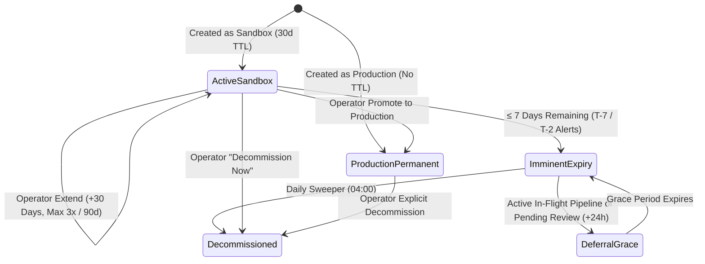

# Autonomous Workload Lifecycle & Decommissioning

StackVend includes a sandbox lifecycle engine designed to limit cloud sprawl by automatically decommissioning temporary test workloads. A workload flagged as a sandbox has an expiry date (30 days by default); operators can extend it, promote it to a permanent workload, or decommission it early.

> **Public preview.** Decommissioning deletes cloud resources. Try the lifecycle features on disposable workloads first.

---

## 1. Lifecycle States

---

## 2. Intent Detection & Auto-Classification

When specifications are submitted via the UI or ingested from Google Docs, StackVend's detection logic (`shared/sandbox_detection.py`) decides whether a workload describes itself as an ephemeral sandbox. It is pattern-based, so it can be wrong in both directions; the creation form lets the operator override the result.

* **Trigger phrases**: patterns such as *"deploy this as a sandbox"*, *"sandbox environment"*, *"temporary sandbox"*, *"ephemeral sandbox"*, *"POC sandbox"*, *"throwaway environment"*, *"disposable environment"* or *"evaluation environment"*.
* **Custom durations**: parses simple timeframes such as *"for 14 days"* or *"60 day ttl"*, defaulting to 30 days.
* **Third-party exclusions**: ignores references to a vendor's sandbox (for example a payment provider's test environment) so that they do not mark the workload itself as temporary.

---

## 3. Operator Controls

From the Control Center Workload Details Hero Card, operators have three one-click actions:

### A. Extend (+30 Days)
* Adds 30 days (or configured days) to the expiration timestamp.
* Enforces strict red-team guardrails:
  * **Ceiling**: Maximum **3 extensions** permitted per workload.
  * **Lifespan Cap**: Maximum **90 cumulative days** allowed.
* Automatically resets advance warning flags and writes an immutable audit record in Firestore.

### B. Promote to Production
* Permanently disables autonomous decommissioning (`is_sandbox: false`, `sandbox_auto_decommission: false`).
* Status transitions to `PROMOTED`.
* All cloud resources, IAM bindings, and DNS configurations remain active indefinitely.

### C. Decommission Now
* Immediately triggers teardown without waiting for the countdown to expire. Decommission deletes the workload's child Google Cloud project; the Git repositories and Terraform state are kept, and redeploying creates a new child project.

---

## 4. Autonomous Daily Sweeper

A Cloud Scheduler job (`castor-sandbox-workload-sweeper`) runs the `sandbox-workload-sweeper-job` Cloud Run job daily at **04:00 (America/New_York)**. It runs the same sweep as the administrator's manual trigger (`POST /api/workloads/sweep-expired-sandboxes`), as its own service account, which project vending accepts for sandbox expiry deletes:

1. **Advance Warnings**:
   * **T-7 days**: a first advance warning is recorded when 7 or fewer days remain.
   * **T-2 days**: an urgent warning is recorded when 2 or fewer days remain.
2. **Grace Deferrals (+24h)**:
   * **In-Flight Pipelines**: If an agent swarm is actively generating code, teardown is automatically deferred by 24 hours.
   * **Pending Reviews**: If a release gatekeeper approval is waiting for human code review, teardown is deferred by 24 hours.
3. **Execution**: If expired and no deferral conditions are met, the sweeper decommissions the workload (at most 10 per run).

---

## 5. Safeguards during decommissioning

The decommission and sweep code includes these protections:

* **Platform self-preservation**: refuses to tear down the platform's own host project or workloads with reserved platform names.
* **Project lien release**: lists and releases project liens through Cloud Resource Manager v3 before requesting project deletion.
* **IPAM CIDR preservation**: decommissioned address ranges are marked `RESERVED_DECOMMISSIONED` in Firestore so they are not immediately reused.
* **DNS cleanup**: removes DNS records for the workload from the platform's managed zone, when one is configured (`DNS_MANAGED_ZONE`).
* **State archival**: copies the Terraform/OpenTofu state to a timestamped object in the platform state bucket. On a
  Shared install the state already lives in the platform bucket, so the copy (then the delete of the old object)
  happens after the project delete; a failed copy is a warning. On a Per-workload install, a workload with a ready
  runner identity keeps its state in its own bucket, inside the project, so the copy happens *before* the delete. If
  that copy fails, the decommission stops and the project is not deleted (`DECOMMISSION_STATE_ARCHIVE_FAILED`). The
  exception is an approval minted with **Delete without a state archive**: then the delete goes ahead, and the state
  is lost with the project. A migrated workload's old platform copy (every version and the lock that says where the
  state moved) is deleted in the same decommission. A workload that was not backfilled yet follows the Shared order.
* **Cleaner isolation**: the 2-hour cleaner job (`apps/sandbox-cleaner`) never selects anything by name, label or prefix. It only asks project vending to expire entries of the ephemeral-resource ledger whose time is up, and vending's guard decides every delete. In this release vending does not run those expiries yet, so the cleaner deletes nothing; sandbox workloads expire through the daily sweeper (section 4).
