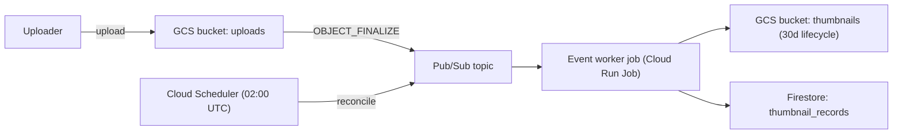

# Synthetic Workload S1: Event-Driven Thumbnail Pipeline (no HTTP service)

## 1. Executive Summary & Objective
* **Product ID**: `test-s1-thumbnail-worker`
* **Complexity Level**: Tier 1 (Low-Cost)
* **Lifespan**: 30-Day Sandbox Workload (`is_sandbox: true`, `sandbox_ttl_days: 30`)
* **Primary Objective**: An asynchronous worker with no public or internal HTTP endpoint: work arrives only as Pub/Sub messages and is processed by a batch job.

### Workload Form Submission Prompt (Copy & Paste)
> Please deploy an event-driven image thumbnail pipeline with no web server. Users upload images into a Cloud Storage bucket named `uploads`; every finalized object publishes a notification to a Pub/Sub topic. A containerized worker job consumes those messages, downloads the image, writes 128px and 512px JPEG thumbnails into a second bucket named `thumbnails` (30-day lifecycle deletion), and records `{object_name, sizes, processed_at}` in a Firestore collection named `thumbnail_records`. A Cloud Scheduler job publishes a `reconcile` message every night at 02:00 UTC so the worker re-processes any upload that has no record yet.
>
> The worker is a Python job (no HTTP server, no health endpoint, no Dockerfile: Google Cloud Buildpacks only) that reads one batch of messages per execution and exits. Keep it scale-to-zero and cheap: 1 vCPU, 512 MiB, at most one task at a time. Include pytest unit tests for the thumbnail sizing and the reconcile logic.

---

## 2. Architecture

### Resources
1. Event worker (Pub/Sub subscription + Cloud Run Job), 1 vCPU / 512 MiB, max one concurrent task.
2. Cloud Storage buckets `uploads` and `thumbnails` (regional, standard, uniform bucket-level access).
3. Pub/Sub notification from `uploads` on object finalize.
4. Firestore (native mode) collection `thumbnail_records`.
5. Cloud Scheduler job, cron `0 2 * * *`, UTC.

## 3. Acceptance
* No HTTP service exists; the worker is the only compute.
* Thumbnails appear in `thumbnails` within one job execution after an upload.
* `pytest` passes.
