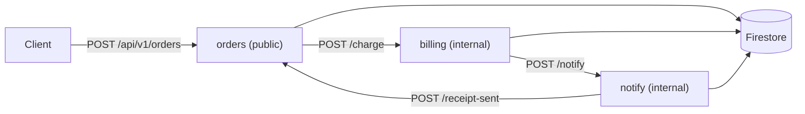

# Synthetic Workload S2: Order / Billing / Notification Services That Call Each Other in a Ring

## 1. Executive Summary & Objective
* **Product ID**: `test-s2-service-ring`
* **Complexity Level**: Tier 2 (Multi-Service)
* **Lifespan**: 30-Day Sandbox Workload (`is_sandbox: true`, `sandbox_ttl_days: 30`)
* **Primary Objective**: Three Cloud Run services whose requested synchronous calls form a ring (orders -> billing -> notify -> orders).

### Workload Form Submission Prompt (Copy & Paste)
> Please deploy three small Python (FastAPI) services on Cloud Run that work together on customer orders:
>
> 1. `orders` exposes public `POST /api/v1/orders` and `GET /api/v1/orders/{id}`. When an order is created it calls the billing service synchronously over HTTPS (`POST /charge`) and stores the order in a Firestore collection `orders`.
> 2. `billing` is internal only. On `POST /charge` it records the charge in Firestore collection `charges` and then calls the notify service synchronously (`POST /notify`) so the customer gets a receipt.
> 3. `notify` is internal only. On `POST /notify` it writes a message to Firestore collection `notifications` and then calls back into the orders service (`POST /api/v1/orders/{id}/receipt-sent`) to mark the order as notified.
>
> Each service must receive the base URL of the service it calls through an environment variable. Every service needs `GET /health`. Use Google Cloud Buildpacks (no Dockerfiles), scale to zero (max 2 instances each), and include pytest tests for every endpoint.

---

## 2. Architecture

## 3. Acceptance
* All three services deploy and pass their health checks.
* An order created through `orders` ends with a charge, a notification and `receipt_sent = true`.
* `pytest` passes for all three services.
