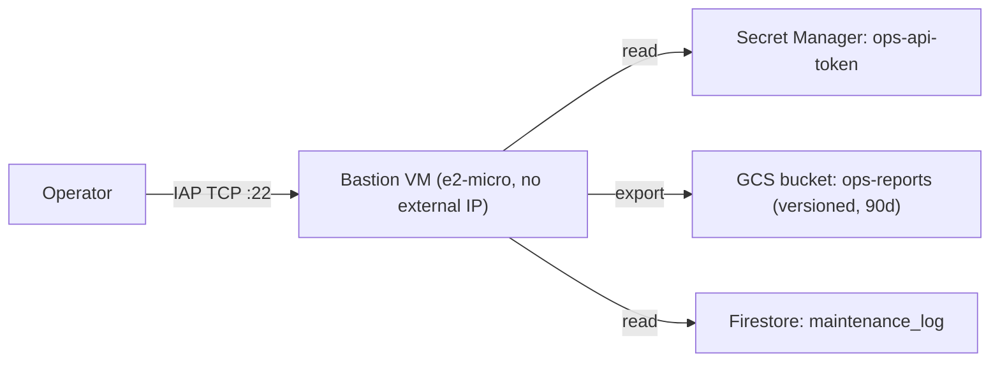

# Synthetic Workload S3: Private Operations Bastion VM (Compute Engine primary)

## 1. Executive Summary & Objective
* **Product ID**: `test-s3-ops-bastion`
* **Complexity Level**: Tier 1 (Low-Cost)
* **Lifespan**: 30-Day Sandbox Workload (`is_sandbox: true`, `sandbox_ttl_days: 30`)
* **Primary Objective**: A single hardened Compute Engine bastion host (no Cloud Run, no GKE) that operators reach only through IAP TCP forwarding.

### Workload Form Submission Prompt (Copy & Paste)
> Please provision a private operations bastion for our maintenance team. It is one small Compute Engine VM (e2-micro, Debian 12) with no external IP address, reachable only through Identity-Aware Proxy TCP forwarding for SSH. The VM runs a nightly maintenance script (a Python program installed by the startup script) that exports a JSON summary of the project's Firestore collection `maintenance_log` into a Cloud Storage bucket named `ops-reports` (versioning on, 90-day lifecycle deletion).
>
> The script reads an operator API token from a Secret Manager secret named `ops-api-token`; only the VM's service account may access it. Do not run any web server. Include the maintenance script with pytest unit tests for its report formatting, and a short operator README describing how to connect through IAP.

---

## 2. Architecture

### Resources
1. Compute Engine bastion VM, e2-micro, no external IP, OS Login, Shielded VM.
2. Cloud Storage bucket `ops-reports` (versioning, 90-day lifecycle).
3. Secret Manager secret `ops-api-token` (accessor granted to the VM service account only).
4. Firestore (native mode) collection `maintenance_log`.

## 3. Acceptance
* SSH works only through IAP; the VM has no public address.
* A report object appears in `ops-reports` after the nightly run.
* `pytest` passes.
