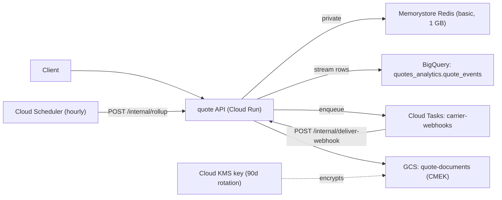

# Synthetic Workload S5: Quote API with Redis Cache, BigQuery Analytics, Cloud Tasks and CMEK

## 1. Executive Summary & Objective
* **Product ID**: `test-s5-quote-platform`
* **Complexity Level**: Tier 2 (Managed services breadth)
* **Lifespan**: 30-Day Sandbox Workload (`is_sandbox: true`, `sandbox_ttl_days: 30`)
* **Primary Objective**: One Cloud Run service that depends on managed services none of the bundled examples use: Memorystore for Redis (private networking), BigQuery, Cloud Tasks, Cloud Scheduler and a Cloud KMS key.

### Workload Form Submission Prompt (Copy & Paste)
> Please deploy a shipping-quote API on Cloud Run (Python, FastAPI). `POST /api/v1/quotes` computes a price from `{origin, destination, weight_kg}` and caches results for 10 minutes in a Memorystore for Redis instance (basic tier, 1 GB) that is reachable only over private networking. Every quote is streamed as a row into a BigQuery dataset `quotes_analytics`, table `quote_events` (partitioned by day).
>
> When a quote is accepted (`POST /api/v1/quotes/{id}/accept`), the API enqueues a Cloud Tasks task on a queue named `carrier-webhooks` that later calls back `POST /internal/deliver-webhook` on the same service to notify the carrier. A Cloud Scheduler job calls `POST /internal/rollup` hourly to write an aggregate row per route into the same dataset. Accepted-quote PDFs are stored in a Cloud Storage bucket named `quote-documents` encrypted with a customer-managed Cloud KMS key (90-day rotation).
>
> Include `GET /health`, Google Cloud Buildpacks only (no Dockerfiles), min instances 0 / max 3, and pytest tests with Redis and BigQuery mocked.

---

## 2. Architecture

## 3. Acceptance
* Redis has no public endpoint; the service reaches it privately.
* Quotes appear in BigQuery; accepted quotes trigger exactly one webhook task.
* `pytest` passes.
