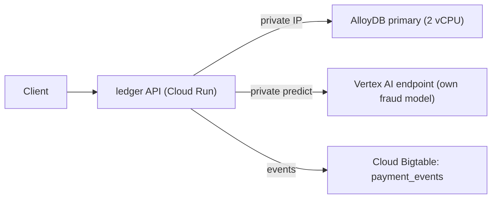

# Synthetic Workload S8: Ledger API with AlloyDB, a Vertex AI Endpoint and Bigtable

## 1. Executive Summary & Objective
* **Product ID**: `test-s8-ledger-platform`
* **Complexity Level**: Tier 2 (Managed services breadth)
* **Lifespan**: 30-Day Sandbox Workload (`is_sandbox: true`, `sandbox_ttl_days: 30`)
* **Primary Objective**: One Cloud Run service that depends on the three managed data services no other example uses (TI-5-R2): AlloyDB for PostgreSQL (private networking), a Vertex AI endpoint the workload owns (private networking) and Cloud Bigtable.

### Workload Form Submission Prompt (Copy & Paste)
> Please deploy a payments-ledger API on Cloud Run (Python, FastAPI). `POST /api/v1/payments` records a payment `{account_id, amount_cents, currency}` in an AlloyDB for PostgreSQL cluster (one primary instance, 2 vCPU) that is reachable only over private networking; the service connects to the primary instance's private IP address.
>
> Before a payment is recorded, the API asks our own fraud-scoring model for a score. The model is deployed by our data science team to a Vertex AI endpoint that this workload creates and owns (a dedicated endpoint, peered privately with the workload's network); the service sends online prediction requests to that endpoint and rejects payments scoring above 0.9. Do not call Gemini or any other Google model.
>
> Every payment is also written as an event to a Cloud Bigtable instance (one node, SSD) in a table `payment_events` with the column family `evt`, keyed by `account_id#timestamp`, for the history view `GET /api/v1/accounts/{id}/history`.
>
> Include `GET /health`, Google Cloud Buildpacks only (no Dockerfiles), min instances 0 / max 3, and pytest tests with AlloyDB, the Vertex AI endpoint and Bigtable mocked.

---

## 2. Architecture

## 3. Acceptance
* AlloyDB and the Vertex AI endpoint have no public endpoint; the service reaches both privately.
* Payments appear in AlloyDB and as events in Bigtable; a high fraud score rejects the payment.
* `pytest` passes.
